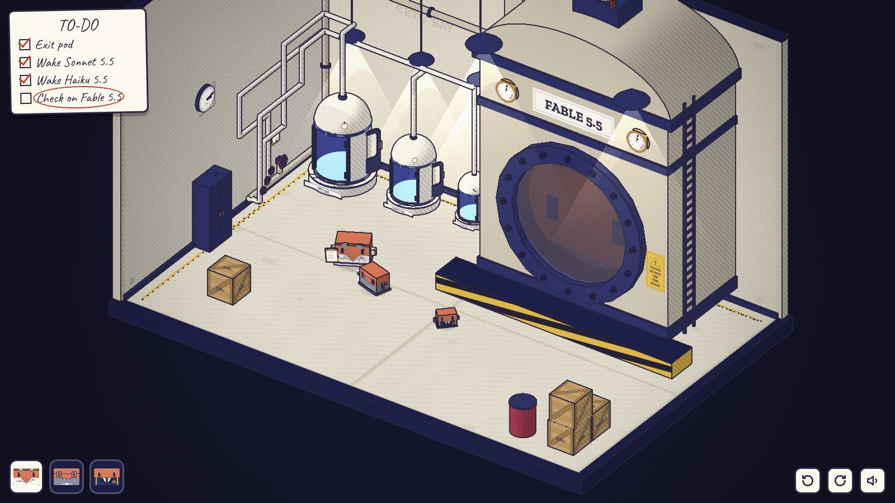

# 请勿敲击玻璃 · PLEASE DO NOT TAP THE GLASS

一个 Clawd 同人网页解谜游戏，承接 [clawd-lab「实验室奇妙夜」](https://github.com/fish2lab/clawd-lab)。

开场先把短片玩一遍：Opus 醒来，叫醒 Sonnet 和 Haiku，三只叠成一摞，Haiku 敲了玻璃。这一次玻璃整块炸开，Fable 5.5 挣脱了容器。然后回到 5.5 系列发布前 90 天，一章一个训练阶段（预训练、监督微调、强化学习、蒸馏、递归自我改进），所有谜题都发生在这间实验室里。



**当前状态：序章可玩。** 用浏览器打开 [index.html](index.html) 即可，双击本地文件也能运行。

- 设计方案：[docs/DESIGN.md](docs/DESIGN.md)
- 箱庭截图：[docs/diorama/](docs/diorama/)
- 关键帧（v0.2 的 2D 分镜，作为美术参考）：[docs/keyframes/](docs/keyframes/)、[keyframes.html](keyframes.html)

## 操作

| | |
| --- | --- |
| 点击地面 / 物体 | 当前的 Clawd 走过去，做它能做的事 |
| 拖动 | 擦霜 |
| 点左下角头像、另一只 Clawd 的身体，或按 Tab | 切换角色 |
| 点另一只 Clawd 的头顶 | 当前这只爬上去（只能爬到比自己大的身上） |
| Q / E 或右下角按钮 | 旋转箱庭 |
| 滚轮 | 缩放 |

画面上没有操作提示。角色做不到的时候，头上会冒出一个图形气泡：够不着、太重、锁着、没反应。

## 做法

- clawd-lab 的渲染器（skia + Python）先逐行移植到了 Canvas 2D，用来画关键帧，也用来画 3D 里的贴图（Clawd 的脸、标签、仪表、清单）。
- 箱庭用 Three.js（`vendor/three.min.js`，r149）。自定义着色器给每个物体两档明暗和屏幕空间排线，后期通道用深度和法线勾出墨线，再加纸张颗粒和暗角，颜色和短片逐像素一致。
- 纯静态网页，不用框架，也不需要构建。

```bash
# 截箱庭画面（需要 Node 和 Playwright 的 Chromium）
node tools/shoot3d.mjs /tmp/shots room steam locker stack back breakout
# 用真实点击自动通关序章
node tools/playtest.mjs /tmp/playtest
# 重新导出关键帧
node tools/shoot.mjs /tmp/kf
pip install pillow && python tools/pack_keyframes.py /tmp/kf
```

## 授权

- 代码：MIT
- Three.js：MIT，许可文本在 `vendor/three-LICENSE.txt`
- 字体：SIL Open Font License，许可文本在 `assets/fonts/`。`zcool-subset.woff2` 是站酷庆科黄油体的子集。
- 非官方同人作品。Clawd、Claude 及各模型名称归 Anthropic 所有，本项目与 Anthropic 无关。
