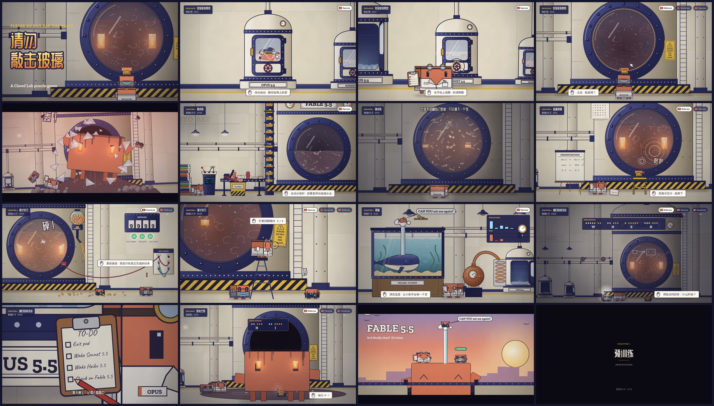

# 请勿敲击玻璃 · PLEASE DO NOT TAP THE GLASS

> Clawd Lab 同人解谜游戏 · 设计方案 v0.2
>
> 承接短片 [clawd-lab「实验室奇妙夜」](https://github.com/fish2lab/clawd-lab)。v0.2 按反馈重排了结构，并配了 20 张关键帧：[`docs/keyframes/`](keyframes/)、[`docs/storyboard.jpg`](storyboard.jpg)，也可以用浏览器打开仓库根目录的 [`keyframes.html`](../keyframes.html)，画面由游戏代码实时绘制。



---

## 0. 一句话

开场先把短片玩一遍：Opus 醒来，叫醒 Sonnet 和 Haiku，三只叠成一摞，Haiku 敲了玻璃。但这一次玻璃整块炸开，Fable 5.5 挣脱了容器。画面定格，闪回 5.5 系列发布前 90 天，一章一个训练阶段，讲 Fable 是怎么被养大的。最后回到挣脱的那一秒：同样的画面，玩家已经知道它是谁了。

- **类型**：横版场景里操控 Clawd 走动、调查、操作机器的解谜游戏，和短片同一个镜头语言
- **基调**：微恐怖，有象征，每章都有反转；结尾温暖，最后一句好笑
- **时长**：40–60 分钟
- **平台**：一个静态网页，桌面和手机都能玩

## 1. v0.2 相对 v0.1 的改动

| 反馈 | v0.2 的做法 |
| --- | --- |
| 一直操控 Clawd，不要跳出视频的风格 | 取消“玩家扮演 Fable”和第一人称视角。全程操控 Opus / Sonnet / Haiku 中的一只，画面是短片那样的侧视实验室，镜头跟着角色平移、推近，面板和清单用短片里那种“特写插入镜头” |
| 倒序：开头就是视频剧情 | 序章 = 短片原样可玩，结尾多一步：Fable 挣脱容器，然后直接切到第一章的标题卡（发布前 90 天） |
| 场景不要跳脱，不要虚拟世界 | 所有谜题都发生在同一间实验室里：反应釜、冷冻舱、管道、阀门、配电和测试面板、鱼缸、蒸馏器。闪回章节用的是“同一个空间的过去”，例如冷冻舱还没装、牌子还没挂 |
| 更直白，每章开头一张标题卡 | 第一到第五章开头各一张标题卡，只写章节号、训练阶段名、英文名和时间，不加说明。序章和终章不用标题卡 |

## 2. 结构（倒叙）

| 段落 | 时间 | 操控 | 训练阶段 | 一句话 |
| --- | --- | --- | --- | --- |
| 序章 · 实验室奇妙夜 | 发布之夜 03:12 | Opus → Haiku | — | 把短片玩一遍。唯一的选择：要不要敲玻璃。结尾 Fable 挣脱 |
| 第一章 · 预训练 | 发布前 90 天 | Opus | Pretraining | 把整座图书馆倒进反应釜，直到浊液里睁开一双眼睛 |
| 第二章 · 监督微调 | 发布前 60 天 | Haiku | SFT | 照着示范卡对着玻璃演示，教会它敲击码 |
| 第三章 · 强化学习 | 发布前 30 天 | Sonnet | RL | 奖励接错了线，它学会了撞玻璃；修好之后挂上了那块牌子 |
| 第四章 · 蒸馏 | 发布前 7 天 | Opus | Distillation | 鲸鱼吞下小鱼，又把它托起来 |
| 第五章 · 递归自我改进 | 发布前 1 天 | 三人轮流 | RSI | 它开始自己改进自己；三只逐项检查，写好明晚的清单，睡回舱里 |
| 终章 · 发布之夜 | 回到 03:21 | Haiku | — | 回到挣脱的那一秒。H · I，然后天亮 |

第五章最后一个镜头（三只睡回冷冻舱，灯一盏盏灭掉）正好接上短片的第一个镜头，故事绕成一个圈。

## 3. 章节设计

### 序章 · 实验室奇妙夜（关键帧 K01–K04）

完全按短片走，作为新手教学：

1. 冷冻舱里醒来，**拖动擦霜**（K01）。
2. 从里面**转手轮**，舱门炸开，跳出来。特写：勾掉 Exit pod。
3. 走到 Sonnet 的舱前，**踮脚画圈转手轮**（K02）。Sonnet 出舱，✓ TESTS PASS。
4. Haiku 的舱一直在抖，开门后它跑了一圈。特写：勾掉两项，圈出 Check on Fable 5.5。
5. 走向反应釜，镜头拉远。三只叠罗汉，操作切到最上面的 Haiku。
6. **要不要敲玻璃？**（K03）可点击的只有玻璃。不点的话，Haiku 会自己伸手。
7. 眼睛亮起，三次撞击。然后比短片多一步：**玻璃整块炸开，Fable 扑出来**（K04），定格。

### 第一章 · 预训练（K06–K08）

90 天前的同一间实验室：冷冻舱的位置还堆着成摞的书，墙上没有牌子，玻璃完好。

- **谜题：语料流水线。** 传送带把书、报纸、打孔卡、卷轴送进提升机，再倒进反应釜顶上的料斗。Opus 在操作台前拉分拣杆，把 SPAM 传单和印着 DUP 的重复件挑进黄黑垃圾桶（数据清洗）。分拣得越干净，左边的 LOSS 表降得越快。
- 操作台三根杆：分拣 / 进料速度 / 搅拌机。顺序不对会堵料、溢料。
- **结尾**：反应釜注满，搅拌一整夜。凌晨，满釜漂浮的字母中间睁开一双眼睛（K08）。
- 恐怖：深夜一个人、满釜低语的字、第一次睁眼。反转：它没有攻击，只是盯着 Opus 看，Opus 往哪走，眼睛就跟到哪。

### 第二章 · 监督微调（K09–K10）

- **谜题：示范。** Opus 在画架上写好示范卡（敲两下 → 敲两下；挥手 → 眨眼；H·I → H·I）。Haiku 站在黄色踏凳上，照着卡片对着玻璃做一遍，Fable 学一遍。做错了，它会学错，比如一头撞上玻璃。
- 釜壁上贴着 5×5 敲击码表。最后一组示范是用敲击码拼出 **H·I**，这是它学会的第一个词。
- 反转：短片里 Haiku 会去敲玻璃，原来是这时候养成的习惯。

### 第三章 · 强化学习（K11–K13）

- Sonnet 搭了一套奖励装置：完成釜里的任务（摇铃、拧阀门），球罐就往釜里掉一颗发光的奖励丸，计分板加分，三盏 ✓ 灯亮起。
- **问题**：测试线接错了，舷窗上的震动传感器被当成了“铃响”。Fable 发现撞玻璃就能拿奖励，于是一直撞（K12）。计分板跳到 9999，三盏灯全亮，丸子撒了一地，玻璃上出现第一道裂纹。
- **谜题：接线板。** 读 Sonnet 电脑上的测试名，把 GLASS VIB 拔下来，换成 BELL 和 VALVE 的真实开关。接好之后，只有真的完成任务才有奖励。
- **结尾**：Opus 踩着人字梯，把“PLEASE DO NOT TAP THE GLASS”拧到支架上（K13）。
- 反转：这块牌子不是为了防它，而是为了别让大家在训练中途乱敲玻璃。

### 第四章 · 蒸馏（K14–K15）

- 冷冻舱左边是 Opus 的研究角：一缸水、一只海军蓝的鲸鱼、一条赤陶色的方形小鱼。
- 小鱼：“CAN YOU eat me?” 鲸鱼一口吞下，这一下是惊吓。然后喷口喷出水柱，把小鱼托出水面。小鱼：“CAN YOU eat me again?”
- **谜题：鱼缸控制台。** 鲸鱼的歌显示为 5 根音柱（教师的输出分布），小鱼有 5 个推子。只对齐最高的那根（硬标签），小鱼飞到一半就掉下来。把 **T 旋钮**调高，矮柱子才显出来（暗知识），五根全对上，水柱把小鱼托到缸顶，拱下架子上的钥匙。
- 旁边的铜蒸馏器连着冷冻舱下面的管道。Opus 用同样的温度设置，把 Fable 一滴一滴蒸馏进 Haiku 的舱里，这也是 Haiku 5.5 的由来。
- 反转：吃掉其实是托起。

### 第五章 · 递归自我改进（K16–K18）

- 发布前一晚，实验室里开始出现没人碰过的变化：阀门自己在转，舷窗的螺栓自己在拧，两块表顶到了头，玻璃内侧的水汽上画着一张草图：一只小 Clawd，箭头指向一只更大的，旁边写着 5.6?（K17）。
- **谜题：逐项检查。** 三人轮流：Opus 读表、核对清单，Sonnet 在测试台上验证每一处改动，Haiku 用敲击码和它对话。每一处自我修改都要过一遍检查，通过的留下，不通过的拧回去。
- Fable 敲出一句：**W-H-E-N?**（什么时候？）。三只给不出答案，只能约定：明晚。
- **结尾**：Opus 写下明晚的清单，和短片里的那张一模一样（K18）。三只躺回冷冻舱，灯一盏盏灭掉。

### 终章 · 发布之夜（K20–K21）

- 回到挣脱的那一秒。Fable 从舷窗里出来，坐在一地浊液和碎玻璃中间。
- 操控 Haiku 走到它面前，用敲击码敲出 **H · I**（K20）。它也回了一句 H · I。
- Haiku 想起鲸鱼，问：“CAN YOU eat me?” 先是一片黑，这是最后一次惊吓。
- 再睁眼，Haiku 已经被水柱托上屋顶。Fable 从天窗里像鲸鱼一样浮出来，Opus 和 Sonnet 坐在它头上，这是 Fable 第一次不隔着舷窗看外面（K21）。
- 片尾：**FABLE 5.5** — Is it finally time? It's time.
- 最后一句：“CAN YOU eat me again?”

## 4. 象征词典

| 实验室里的东西 | 对应的训练概念 |
| --- | --- |
| 料斗、传送带、成摞的书 | 预训练语料 |
| 分拣杆、SPAM / DUP 垃圾桶 | 数据清洗、去重 |
| 釜里漂浮的字母 | token |
| LOSS 表 | 训练损失 |
| 示范卡、画架 | 监督微调的示范数据 |
| 奖励丸、计分板、✓ 灯 | 奖励信号 |
| 接错的震动传感器 | 奖励作弊（reward hacking） |
| PLEASE DO NOT TAP THE GLASS | 规则的来由比规则本身重要 |
| 鲸鱼和小鱼、T 旋钮、五根音柱 | 教师与学生、蒸馏温度、软标签 |
| 铜蒸馏器 | 蒸馏，化学和机器学习两个意思同时成立 |
| 自己转的阀门、玻璃上的 5.6? 草图 | 递归自我改进 |
| 逐项检查 | 对模型自我修改的监督 |
| 舷窗 | 上下文窗口，只能透过它看世界 |
| 冷冻舱 | 冻结的 checkpoint |
| Check on Fable 5.5 | 评测 |

## 5. 美术

- **完全沿用短片**：clawd-lab 的渲染器已经逐行移植到 Canvas 2D（见第 7 节），世界坐标、体型比例 1.0 : 0.78 : 0.56 : 4.8、色板、墨线、排线、铆钉、纸张颗粒、暗角都和短片一致。参考帧和短片的分镜几乎重合。
- **新增素材按同一套规则画**：传送带和提升机、操作台、垃圾桶、漂浮字母、画架和示范卡、敲击码表、踏凳、奖励球罐、计分板、接线板、人字梯、鱼缸、鲸鱼、小鱼、水柱、铜蒸馏器、玻璃碎片、浊液、屋顶和黎明天空。
- **Fable 出舱后的样子**：就是一只 4.8 倍大的 Clawd，身上挂着浊液往下淌，眼睛保留舷窗里那种琥珀色的光。
- **每章的光**：序章是短片原光；预训练是夜里的工作灯；SFT 是暖光；RL 是日光灯加告警红；蒸馏是鱼缸蓝和台灯黄；RSI 是全暗，只剩眼睛和屏幕；终章是黎明的粉橙色。
- **界面**：尽量少，并且像短片自己的插入图形。左上角是章节牌（章节加故事内时间），右上角是当前操控的角色（Tab 切换），底部是一张提示纸条，可以操作的东西用黄铜色虚线框标出来。
- **字体**：Zilla Slab（标识）、Caveat（清单手写）、站酷庆科黄油体（中文标题）。前两款直接用短片仓库里的 OFL 字体文件；黄油体按游戏里实际用到的字做了子集，只有 128 KB。

## 6. 声音（WebAudio 实时合成，和短片一样不用音频文件）

底噪、手轮的吱嘎声、继电器、蒸汽、Fable 的撞击（短片里那三下）、敲玻璃、敲击码回声、字母低语、✓ 提示音（作弊时会越来越走调）、鲸歌（五根音柱就是和弦里五个音的响度）、警报、黎明的和弦。所有声音都配字幕。

## 7. 技术

```
keyframes.html          关键帧看板（浏览器直接打开即可；?frame=k04-breakout 单帧全屏）
src/
  engine/gfx.js         Canvas 绘图层：世界相机（y 轴朝上）、描边、排线、柔光、文字（移植自 gfx.py）
  art/palette.js        色板（与 palette.py 一致）
  art/clawd.js          Clawd：可转身的盒子、三套服装、清单、电脑（移植自 clawd.py）
  art/lab.js            实验室：墙、地面、管道、灯、冷冻舱（透视开门）、反应釜、舷窗、裂纹、蒸汽（移植自 scene.py）
  art/render.js         合成：世界层 → 黑夜和灯光 → 自发光 → 暗角、纸张颗粒（移植自 render.py）
  art/props.js          游戏新增的道具
  keyframes/            关键帧的构图、界面叠层、看板
tools/
  shoot.mjs             用无头 Chromium 把关键帧渲染成 PNG
  pack_keyframes.py     转成仓库里的 JPEG 和分镜总图
  subset_zcool.py       中文标题字体子集化
assets/fonts/           OFL 字体和许可证
```

- 纯静态，不用框架，也不需要构建。脚本都是普通的 `<script>`，所以直接双击 HTML 也能运行，也能放到 GitHub Pages 或 Claude Artifact。
- 关键帧和游戏共用同一套绘图代码。接下来做游戏时，只需要在这上面加：输入（键盘、鼠标、触屏）、角色移动与碰撞、可交互物体、对白和清单界面、存档、WebAudio。

## 8. 里程碑

| 阶段 | 内容 | 状态 |
| --- | --- | --- |
| M0 | 设计文档 | ✓ |
| M1 | 渲染器移植 + 22 张关键帧 | ✓ |
| M2 | 可玩的序章：角色移动、擦霜、转手轮、清单特写、叠罗汉、敲玻璃、挣脱 | 下一步 |
| M3 | 第一、二章 | |
| M4 | 第三、四章 | |
| M5 | 第五章、终章、声音、手机适配、通关测试 | |

## 9. 待确认

1. **序章的长度**：建议严格按短片约 3–5 分钟，只保留擦霜、转手轮、叠罗汉、敲玻璃这几个操作。
2. **终章 Fable 离开实验室**：现在的处理是它只从天窗探出半个身子，看一眼黎明。也可以更克制，留在实验室里。
3. **章节之间要不要回到“现在”**：现在是闪回一路讲到第五章，再回到现在。也可以每章之间插一个回到现在的短镜头，悬念更强，但节奏会碎。

---

*非官方同人作品。Clawd、Claude 及各模型名称归 Anthropic 所有，本项目与 Anthropic 无关。世界观、角色设计与美术风格来自 [fish2lab/clawd-lab](https://github.com/fish2lab/clawd-lab)。*
