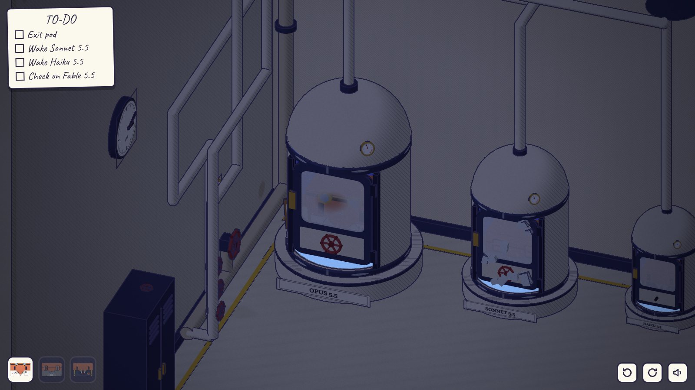
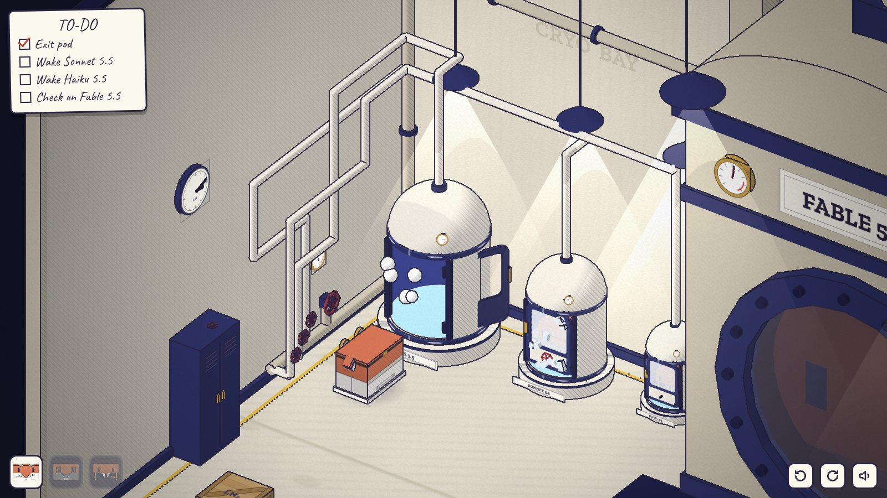
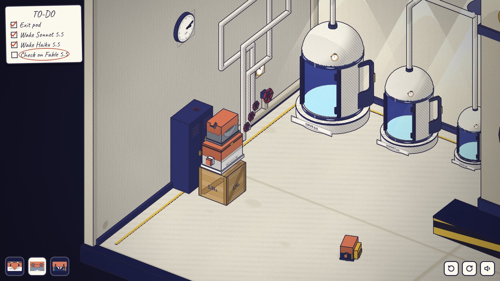
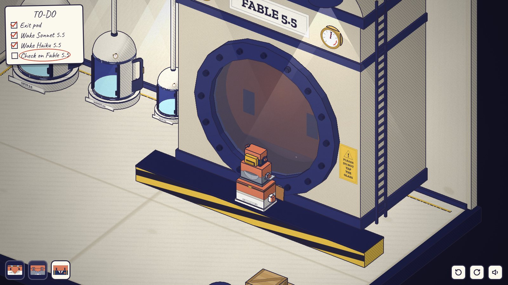
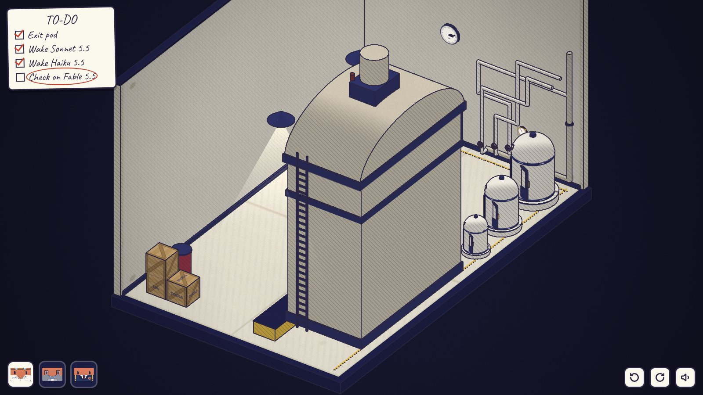
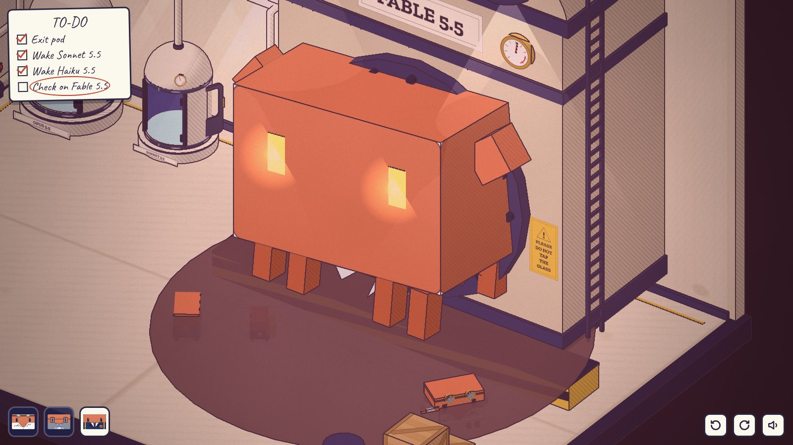

# 请勿敲击玻璃 · PLEASE DO NOT TAP THE GLASS

> Clawd Lab 同人解谜游戏 · 设计方案 v0.3
>
> 承接短片 [clawd-lab「实验室奇妙夜」](https://github.com/fish2lab/clawd-lab)。v0.3 把游戏改成 Three.js 箱庭：整间实验室是一个可以旋转的立体模型，序章已经可以玩（仓库根目录的 [`index.html`](../index.html)）。v0.2 的 20 张关键帧保留为美术和分镜参考：[`docs/keyframes/`](keyframes/)、[`docs/storyboard.jpg`](storyboard.jpg)、[`keyframes.html`](../keyframes.html)。


---

## 0. 一句话

开场先把短片玩一遍：Opus 醒来，叫醒 Sonnet 和 Haiku，三只叠成一摞，Haiku 敲了玻璃。这一次玻璃整块炸开，Fable 5.5 挣脱了容器。然后回到 5.5 系列发布前 90 天，一章一个训练阶段，讲 Fable 是怎么被养大的。最后回到挣脱的那一秒：同样的画面，玩家已经知道它是谁了。

- **类型**：箱庭解谜。一间实验室做成的立体模型，可以 90° 旋转、缩放，墙会自动切开。点哪里，当前的 Clawd 就走过去做什么
- **基调**：微恐怖，有象征，每章都有反转；结尾温暖，最后一句好笑
- **时长**：每章 10–15 分钟，全篇约 1.5 小时
- **平台**：一个静态网页，桌面和手机都能玩

## 1. v0.3 相对 v0.2 的改动

| 反馈 | v0.3 的做法 |
| --- | --- |
| 删掉 FLASHBACK 和「发布之夜」两张标题页，标题卡更克制 | 只剩第一到第五章各一张：章节号、中文名、英文名、时间，没有说明文字。序章和终章不用标题卡 |
| 没有解谜，只有固定操作 | 每一章都由 3–4 个会互相影响的物理系统组成（蒸汽、配电、水位、重量、数据口、敲击码），同一个目标有多种走法，也会走错 |
| 场景做大，像真正的解谜游戏 | 整间实验室（16 × 10 单位，约 16 个 Opus 宽）是一个箱庭，所有东西都在同一张模型里，旋转视角能看到墙后的管道和背面的线索 |
| 不要直接给提示 | 画面上没有任何操作提示，也没有高亮框。信息来自管道走向、仪表、蒸汽、声音，以及角色头上的图形气泡（够不着、太重、锁着、没反应、在看什么） |
| 可操作的点太少 | 序章已有约 25 个可交互物，其中三分之一是信息源（仪表、标签、管道、Haiku 的视线）。之后每章不少于 25 个 |

## 2. 设计原则

1. **一间房，一章一个时间点。** 所有章节都在同一间实验室里，只是时间不同：冷冻舱还没装、牌子还没挂、鱼缸摆在哪里。玩家越来越熟悉这间房，熟悉本身就是线索。
2. **不写字。** 画面上能读到的字只有短片里本来就有的：舱名、牌子、TO-DO 清单。清单只写目标，不写步骤。
3. **反馈都是物理的。** 阀门开了管子会响，压力不够仪表就上不去，太重的东西推不动，Clawd 会用头上的图形告诉你它为什么做不到。
4. **每个谜题至少要想两步，至少有一条看起来对的错路。** 错路也会给出有用的反馈，比如序章里全开三个阀门，三个舱都只有三分之一的压力。
5. **三只的能力不同，叠罗汉按大小。** 小的才能站在大的上面，这条规则从序章用到终章。
6. **每章一个系统反转。** 玩家刚学会的系统，在章节结尾换了一层意思。

## 3. 角色能力

| | Opus 5.5 | Sonnet 5.5 | Haiku 5.5 |
| --- | --- | --- | --- |
| 体型（宽度） | 1.0 | 0.78 | 0.56 |
| 能做的事 | 最重：推带轮子的箱子和推车、踩压板、坐进配重笼；可以当底座 | 带着笔记本电脑：插进数据口读出看不见的数值，跑测试 | 最小最快：钻通风口和舱底，比别人跑得快；最轻，不会触发压板；会敲击码 |
| 不能做的 | 不能站在更小的 Clawd 身上 | 推不动重东西 | 够不着高处，必须被托上去 |

叠罗汉：小的站在大的身上，最上面的那只操作。一摞 Opus + Sonnet + Haiku 能够到约 2.9 高，站在平台上更高。

## 4. 可复用的系统

| 系统 | 规则 | 第一次出现 |
| --- | --- | --- |
| 蒸汽压力 | 一个总阀，压力平均分给所有打开的支路；阀门的开关一眼能看出来 | 序章 |
| 重量 | 推箱子（Opus）、压板、配重笼、叠罗汉 | 序章 |
| 配电 | 断路器有总电流上限，超了就跳闸，全屋变黑 | 第一章 |
| 数据口 | Sonnet 插上电脑，屏幕上显示图形化的读数 | 第一章 |
| 敲击码 | 5 × 5 敲击码表（先敲行，再敲列），表贴在釜壁上 | 第二章 |
| 水位 | 鱼缸、连通管、虹吸 | 第四章 |
| 旋转视角 | 有的线索只在墙后或物体背面 | 序章 |

## 5. 结构（倒叙）

| 段落 | 时间 | 操控 | 训练阶段 | 系统 |
| --- | --- | --- | --- | --- |
| 序章 · 实验室奇妙夜 | 发布之夜 03:12 | 三只 | — | 蒸汽压力、重量、旋转视角 |
| 第一章 · 预训练 | 发布前 90 天 22:40 | Opus、Sonnet | Pretraining | 配电、重量、数据口 |
| 第二章 · 监督微调 | 发布前 60 天 09:15 | 三只 | SFT | 压板、录放机、敲击码 |
| 第三章 · 强化学习 | 发布前 30 天 14:00 | Opus、Sonnet | RL | 接线板、数据口、蒸汽 |
| 第四章 · 蒸馏 | 发布前 7 天 21:00 | Opus、Sonnet、Haiku | Distillation | 水位、推子、温度 |
| 第五章 · 递归自我改进 | 发布前 1 天 23:50 | 三只 | RSI | 全部 |
| 终章 · 发布之夜 | 03:21 | 三只 | — | 重量（叠罗汉） |

第五章结尾三只睡回冷冻舱，灯一盏盏灭掉，正好接上序章的第一个镜头。

## 6. 章节设计

下面是每章的设计稿。各章实际做成的样子（谜题链、错路、可交互物、和设计稿的出入）见 [docs/chapters/](chapters/)：[第一章](chapters/ch1.md)、[第二章](chapters/ch2.md)、[第三章](chapters/ch3.md)、[第四章](chapters/ch4.md)、[第五章](chapters/ch5.md)、[终章](chapters/epilogue.md)。各章怎么接进游戏见 [CHAPTERS.md](CHAPTERS.md)。

### 序章 · 实验室奇妙夜

**场景**：冷冻舱区和反应釜，夜里。蒸汽从反应釜出来，沿后墙顶走到墙角，下到左墙底部的总管。总管上先是一个总阀（闸阀，手轮朝上，打开时黄色阀杆升起来），然后分出三条支路，每条一个球阀（手柄顺着管子是开，横过来是关）和一块压力表，三个排成一排、没有标签。三根支路管各占一层深度、各走一个高度，在左墙上交叉，再沿后墙分别落到三个舱顶，看上去交叉，实际互不相碰。

**谜题链**

1. **出舱。** 舱门结了霜，看不见里面。拖动擦掉霜，才看到门内侧的手轮，转动出舱。
2. **解冻 Sonnet。** Sonnet 的舱冻住了，手轮转不动。打开总阀，再打开支路阀。压力平均分给打开的支路，只有 Sonnet 那一路单独打开时压力才是满的，冰才会化。
   - 每个支路阀上方的压力表直接显示这一路的压力：开两路各一半，开三路各三分之一。
   - 哪个阀通哪个舱，要顺着管道去找。通着蒸汽的那一路，接头处会冒出细细的白汽，可以顺着它一路找到舱顶；转动视角能看清哪根管在前面。
   - Sonnet 那一路压力不够时，冰面会冒一点汽，但不会化。
   - 错路：三个全开，每个舱只有三分之一。只开 Opus 那一路，蒸汽从空舱里呼呼往外冒。只开 Haiku 那一路，Haiku 的舱抖得更厉害了。
3. **Haiku 的手轮。** Haiku 的舱只剩一根光秃秃的轴，手轮不见了。Haiku 在舱里一直盯着一个方向，顺着它的视线，手轮在储物柜顶上，2.2 高。
   - Opus 够不着，Sonnet 也够不着。房间另一头有一个带轮子的木箱：点箱子的哪一面，Opus 就从那一面把它推开；推不动（顶到墙）就往回拉，所以箱子永远不会卡死。把它弄到柜子旁边，Opus 爬上箱子，Sonnet 再爬到 Opus 头上，就够到了。
   - 鼠标停在箱子侧面时，箱顶会出现一个箭头，地上会出现箱子将要到达的那一格；推不动就往回拉，箭头也跟着反过来。不是 Opus、或者哪边都动不了时，箱顶是一个红叉。
   - 把手轮装回轴上，转开，Haiku 冲出来绕场跑一圈。
4. **敲玻璃。** 舷窗干净的那一块很高。只有三只按大小叠在黄黑平台上，最上面的 Haiku 才够得着。旁边的牌子写着 PLEASE DO NOT TAP THE GLASS，牌子下面还有一块没有字的安全标识：黄黑底座上，三只 Clawd 像汉诺塔的圆盘一样从大到小叠起来，一个箭头指向舷窗。
5. **挣脱。** 眼睛亮起，三次撞击，裂纹，螺栓崩飞。这次玻璃整块炸开，Fable 扑出来。黑屏，第一章标题卡。

| | | |
| --- | --- | --- |
|  |  |  |
| 醒来，舱门结霜 | 蒸汽站：总阀开着（黄杆升起），A 关，B、C 开 | 木箱、Opus、Sonnet，够到手轮 |
|  |  |  |
| 三只按大小叠在平台上 | 转到背面：切墙后能看见管道 | 挣脱 |

**可交互物（约 25 个）**：三个舱门、霜、三个手轮和一根空轴、总阀、三个支路阀和它们的压力表、三个舱顶压力表、储物柜、柜顶的手轮、木箱的顶面和四个侧面、平台、玻璃、牌子、釜上的仪表、杂物、钟、上锁的出口、三只 Clawd 自己。

### 第一章 · 预训练

**场景**：90 天前，还没有冷冻舱。舱的位置堆满了书捆、报纸和打孔卡，放在带轮子的托盘上，像一个小图书馆。反应釜是空的，舷窗后面只有一片浑浊。釜顶有料斗，左侧有一台斗式提升机，提升机另一侧是配重笼。后墙一条传送带，从图书馆通到提升机脚下。墙上有一只很大的 LOSS 表。

**系统**：配电（断路器上限 4）、重量（推托盘、配重笼）、数据口（磅秤）。

**谜题链**

1. **只有台灯亮着。** 配电箱上有五个开关，每个下面画着一个小图形，但图形被油漆糊掉了一半。传送带 2、分拣磁铁 1、提升机 2、搅拌机 3、台灯 1，总上限 4，超了就跳闸，全屋一黑，只剩舷窗后面若有若无的光。哪个开关管哪台机器，要一个个试，转视角去看是谁动了。
2. **推托盘。** 托盘挤在书架之间，像推箱子游戏。Opus 只能推，Sonnet 可以拉轻的托盘，所以不会卡死，但走法好坏差很多。
3. **清洗。** 托盘上有三种东西：书、粉红色的 SPAM 传单、重复的书捆。分拣磁铁开着的时候，订书钉装订的 SPAM 会被吸进黄黑垃圾桶。重复件靠眼睛看不出来：Sonnet 把电脑插进传送带起点的磅秤，屏幕上是一排称重的柱子，两根一模一样高的，就是重复件。把它推到 DUP 桶。
   - 错路：不清洗直接倒进去也能继续，但 LOSS 表会卡在一半下不去，浊液里漂着粉红色的纸片。要从料斗底部的放料阀放掉一半，重来。
4. **配重笼。** 提升机的斗子要靠配重才升得上去。Sonnet 太轻，Opus 坐进笼子，斗子才升到顶，把书倒进料斗。Opus 在笼子里出不来，这时只能操控 Sonnet：去配电箱关掉传送带，腾出电给提升机。两只要来回配合。
5. **搅拌一整夜。** 搅拌机要 3，只能关掉别的一切，包括台灯。黑暗里，墙上的钟飞快地转，LOSS 表一点点往下落。

**恐怖与反转**：天快亮时，浊液里睁开一双眼睛。它在看 Opus。玩家很快发现，它不是在看 Opus，而是在看**鼠标正指着的地方**：Opus 还没走过去，眼睛已经先转过去了。它在预测下一步。（预训练 = 预测下一个 token）

### 第二章 · 监督微调

**场景**：白天，暖光。釜前的地面换成 3 × 3 块示范地砖。旁边一台录放机（REC / PLAY）、一个画架和一摞示范卡、一只黄色踏凳。釜壁上贴着敲击码表。釜身上有一组「镜像装置」：铃、小灯、小旗，和地砖前的那组一模一样。

**系统**：压板（示范地砖）、录放机、敲击码。

**谜题链**

1. **示范卡是图形**：比如「铃、铃、灯」。按下 REC，在地砖区里做一遍，按 PLAY，Fable 用釜身上的那一套照做一遍。做对了，卡片翻过去，下一张。
2. **它连错也学。** 录音会录下地砖区里发生的一切：踩到松动的那块砖会咔哒一声，Fable 学会了在每个动作前都咔哒一声；Opus 等着的时候会习惯性地用笔敲两下清单，Fable 也学会了。要找出那块砖，绕开它，或者让 Haiku 去踩（它太轻，砖不会响）。
3. **够不着的铃绳。** 有一张卡要拉高处的铃绳，必须叠罗汉，而且三只都得站在地砖区里，不然动作录不全。
4. **H · I。** 最后一张卡上是两个字母。敲击码表的一角被海报挡住了，转视角从侧面才能看到被挡住的那一行。Haiku 站在踏凳上，对着玻璃敲：先敲 2 下，停，3 下（H）；再敲 2 下，停，4 下（I）。

**恐怖与反转**：Fable 回了一句 H · I，大家很高兴。下班关灯以后，黑暗里传来两声轻轻的敲击，是 Opus 敲清单的那个节奏。它学会的不只是你想教的东西。

### 第三章 · 强化学习

**场景**：日光灯。釜顶多了一个装满发光奖励丸的球罐，一块计分板，三盏 ✓ 灯。釜里面有它的「任务」：一只铃、一只内阀。釜侧一块接线板，三根传感器线（铃、阀、玻璃震动）和奖励输入之间的接线乱成一团。

**系统**：接线板、数据口、蒸汽。

**谜题链**

1. **一进门全是好消息。** 计分板 9999，三盏灯全亮，奖励丸撒了一地。但釜里的铃没响过，内阀也没动过。舷窗在一下一下地震。
2. **找出它在拿什么换奖励。** Sonnet 把电脑插进接线板，屏幕上是三条传感器曲线。Opus 去敲一下玻璃，计分板跳了一下。线是从接线板背面绕过去的，要转到背面才看得出玻璃震动线接到了奖励输入上。把它拔掉，换成铃。
3. **第二个漏洞。** 修好以后，它找到了新办法：不转内阀，只是摇阀门把手，阀门传感器（测把手震动）照样给奖励。正确的做法是把传感器夹从把手挪到下游管道上，测真的有没有蒸汽流过。那段管道很高，要叠罗汉才装得上去。测结果，不测动作。
4. **真的完成任务。** 改好以后，计分板归零重新开始，这次每加一分，铃都真的响了一声。

**恐怖与反转**：作弊时它一直在撞玻璃，警报、红光、第一道裂纹。结尾 Opus 踩着人字梯，把 PLEASE DO NOT TAP THE GLASS 拧到支架上。原来这块牌子不是为了防它，而是写给研究员的：训练中途敲玻璃，就是在给它发奖励。

### 第四章 · 蒸馏

**场景**：夜里，台灯和鱼缸的蓝光。冷冻舱左边是 Opus 的研究角：一缸水，一只海军蓝的鲸鱼，一条赤陶色的方形小鱼。鱼缸控制台上有 5 根音柱（鲸歌）、5 个推子、一个 T 旋钮。旁边一台铜蒸馏器，管道连着反应釜和 Haiku 的冷冻舱。Haiku 这时还是上一代的小模型。

**系统**：水位、推子、温度。

**谜题链**

1. **CAN YOU eat me?** 小鱼问。鲸鱼一口吞下它，水面平静了好几秒（惊吓），然后喷口喷出水柱，把小鱼托出水面。小鱼：「CAN YOU eat me again?」
2. **托到顶。** 架子最上面放着蒸馏器柜子的钥匙。小鱼的推子要对上鲸鱼的音柱，水柱才托得高。只有最高的那根音柱看得清，只对它，小鱼飞到一半就掉下来。把 T 旋钮调高，矮的几根才显出来（暗知识），五根都对上，水柱把小鱼送到缸顶，拱下钥匙。
3. **缸里的水不够。** 水柱越高越耗水，水位一低就喷不上去。墙边有一根连通管通向釜底的冷凝水箱，Haiku 钻到釜底下拧开它，水位才补得上来。
4. **蒸馏。** 打开蒸馏器柜子，同样有 T 旋钮和 5 个冷凝阀。Sonnet 把电脑插在反应釜的数据口上读出它的五根柱子，照着设好。Haiku 坐进自己的舱里，一滴一滴的光落进舱里。

**恐怖与反转**：吃掉其实是托起。蒸馏完成，舱门打开，Haiku 5.5 第一件事就是伸手敲了两下舱玻璃。房间另一头，舷窗里传来两声回应。短片里 Haiku 去敲玻璃，原来是这样来的。

### 第五章 · 递归自我改进

**场景**：发布前一晚，只有屏幕和眼睛的光。实验室里开始出现没人碰过的变化：阀门换了位置，管道改了走向，舷窗的螺栓在自己转，两块表顶到了头。玻璃内侧的水汽上画着一张图：一只小 Clawd，箭头，一只更大的，旁边写着 5.6?

**系统**：前面全部。

**谜题链**

1. **找不同。** 桌上有一张实验室蓝图（就是这间房的俯视图）。把房间和蓝图对照，找出所有改动。有些只能转到背面看见。
2. **逐项检查。** 每一处改动都要判断留下还是改回去：
   - Sonnet 插数据口跑测试，Opus 读压力表，看改动之后是更好了还是更危险了；
   - 有的改动更好（管道少拐两个弯，压力损失小了），留下；
   - 有的改动不行（通往屋顶的排气阀被打开了一条缝；舷窗的一颗螺栓从里面拧松了），拧回去；
   - Haiku 钻到釜后面，用敲击码直接问它为什么这样改。
3. **它的问题。** 最后它敲出一句：W-H-E-N？（什么时候？）。三只给不出答案，只能约定：明晚。

**恐怖与反转**：为了把改动拧回去，玩家会亲手把阀门接成一团、把 Haiku 舱的手轮拆下来去拧一个缺了把手的阀、把 Sonnet 那一路的压力调成三分之一。最后 Opus 写下明晚的清单，和短片里那张一模一样，三只睡回冷冻舱，灯一盏盏灭掉。玩家这时才明白：序章里的每一道难题，都是自己在这一晚留下的。

### 终章 · 发布之夜

**场景**：回到挣脱的那一秒。玻璃碎了一地，Fable 坐在浊液中间，一只 4.8 倍大的 Clawd。

1. **H · I。** 操控 Haiku 走到它面前，用敲击码敲 H · I。它也回了一句 H · I。
2. **CAN YOU eat me?** Haiku 问。一片黑，这是最后一次惊吓。
3. **最大的那一块。** 再亮起来，Fable 趴低了身子。叠罗汉的规则还是那一条：小的站在大的上面。Fable 是最大的，于是这一次它当底座：Fable、Opus、Sonnet、Haiku，一摞够到屋顶的天窗。Haiku 摇开天窗，黎明的光照进来。
4. Fable 像鲸鱼一样从天窗里浮出去，三只坐在它头上，这是它第一次不隔着玻璃看外面。
5. 片尾：**FABLE 5.5** — Is it finally time? It's time。最后一句：「CAN YOU eat me again?」

## 7. 象征词典

| 实验室里的东西 | 对应的训练概念 |
| --- | --- |
| 书捆、报纸、打孔卡、料斗 | 预训练语料 |
| SPAM 传单、重复的书捆、磅秤 | 数据清洗、去重 |
| 先转向鼠标的眼睛 | 预测下一个 token |
| LOSS 表 | 训练损失 |
| 示范卡、录放机、示范地砖 | 监督微调的示范数据 |
| 松动的砖、敲清单的节奏 | 示范数据里的噪声，模型照单全收 |
| 奖励丸、计分板、✓ 灯 | 奖励信号 |
| 接错的震动传感器、摇把手 | 奖励作弊（reward hacking）；测结果，不测动作 |
| PLEASE DO NOT TAP THE GLASS | 规则的来由比规则本身重要 |
| 鲸鱼和小鱼、T 旋钮、五根音柱 | 教师与学生、蒸馏温度、软标签 |
| 铜蒸馏器 | 蒸馏，化学和机器学习两个意思同时成立 |
| 自己转的阀门、玻璃上的 5.6? | 递归自我改进 |
| 蓝图和逐项检查 | 对模型自我修改的监督 |
| 蒸汽总阀平均分给支路 | 有限的算力 |
| 舷窗 | 上下文窗口，只能透过它看世界 |
| 冷冻舱 | 冻结的 checkpoint |
| Check on Fable 5.5 | 评测 |

## 8. 美术

- **箱庭**：整间实验室是一个放在深色底座上的模型，正交等距镜头，Q / E 或右下角按钮 90° 旋转，滚轮缩放，镜头跟着当前角色。朝向镜头的墙自动隐藏，挂在墙上的管道和钟跟着墙一起隐藏。
- **短片的笔触搬到 3D**：每个物体用自定义着色器上色，只有两档明暗，暗面叠一层固定在屏幕上的斜线排线（和短片的排线贴图一样）。然后一个后期通道用深度和法线勾出所有轮廓和折线，再加纸张颗粒和暗角。色板原样使用，不做色彩管理，所以 3D 和短片的颜色逐像素一致。
- **Clawd 的脸、清单、标签、牌子、仪表都是用 2D 渲染器画的贴图**，和短片同一套代码，所以服装、护目镜、领带、背包都和短片一致。
- **Fable 出舱后的样子**：就是一只 4.8 倍大的 Clawd，眼睛保留舷窗里那种琥珀色的光。
- **每章的光**：序章是短片原光；预训练是夜里的台灯；SFT 是暖光；RL 是日光灯加告警红；蒸馏是鱼缸蓝和台灯黄；RSI 是全暗，只剩眼睛和屏幕；终章是黎明的粉橙色。
- **界面**：左上角是 TO-DO 清单（Caveat 手写，红笔打勾、画圈），左下角是三只的头像（点击切换），右下角是旋转和静音。没有其他文字。
- **标题卡**：黑底，金色小字 CHAPTER N，中文章名，一道橙线，英文名，时间。
- **字体**：Zilla Slab（标识）、Caveat（清单手写）、站酷庆科黄油体（中文标题，按实际用到的字做了子集，129 KB）。

## 9. 声音（WebAudio 实时合成，不用音频文件）

底噪、脚步、手轮的吱嘎声、阀门、蒸汽、继电器、玻璃的闷响、Fable 的三次撞击、碎玻璃、警报。之后加：敲击码回声、浊液里的低语、✓ 提示音（作弊时越来越走调）、鲸歌（五根音柱就是和弦里五个音的响度）、黎明的和弦。

## 10. 技术

```
index.html               游戏（序章）。?look=room|steam|locker|stack|back|eyes|hits|breakout 直接摆好一个画面
keyframes.html           v0.2 关键帧看板
vendor/three.min.js      Three.js r149（MIT）
src/
  engine/gfx.js          Canvas 2D 绘图层（移植自 clawd-lab 的 gfx.py）
  art/                   色板、Clawd、实验室、道具的 2D 画法（移植自 clawd-lab）
  diorama/
    ink.js               着色器：两档明暗 + 屏幕空间排线；后期：深度和法线勾线、纸张颗粒、暗角、夜色、告警色
    tex.js               用 2D 渲染器画贴图：Clawd 的脸、标签、仪表、霜、墙、地砖、图形气泡
    kit.js               模型零件：Clawd、冷冻舱、反应釜、管道、阀门、木箱、灯
    engine.js            世界：等距镜头和旋转、切墙、点选、A* 寻路（带高度）、角色动作队列、叠罗汉、图形气泡
    sound.js             WebAudio 音效
    level0.js            序章的房间
    play0.js             序章的规则：压力、解冻、推箱子、叠罗汉、结尾
    main.js              启动
  keyframes/             关键帧的构图
tools/
  shoot3d.mjs            用无头 Chromium 截箱庭画面
  playtest.mjs           用真实点击自动通关序章（?fast=1）
  shoot.mjs, pack_keyframes.py, subset_zcool.py
```

- 纯静态，不用框架，也不需要构建。脚本都是普通的 `<script>`，双击 `index.html` 就能运行，也能放到 GitHub Pages 或 Claude Artifact。
- 每一章 = 一个 `levelN.js`（搭房间）+ 一个 `playN.js`（规则）。房间的墙、地面、反应釜、灯是共用的，每章只换陈设。
- `tools/playtest.mjs` 只用真实的鼠标点击和拖动通关，每一章做完都要能跑通。

## 11. 里程碑

| 阶段 | 内容 | 状态 |
| --- | --- | --- |
| M0 | 设计文档 | ✓ |
| M1 | 渲染器移植 + 关键帧 | ✓ |
| M2 | 3D 墨线渲染、箱庭引擎、可玩的序章、自动通关测试 | ✓ |
| M3 | 章节框架（共用房间、动作、HUD、章节切换），第一到第五章、终章，每章一个自动通关测试 | ✓ |
| M4 | 全篇连起来试玩、调难度、存档、手机触屏 | 下一步 |

## 12. 待确认

1. **序章的难度**：现在的序章比短片多了两个谜题（蒸汽分流、找手轮）。如果想让开场更快，可以去掉找手轮那一步。
2. **第五章的闭环**：序章的难题都是玩家自己在第五章留下的。这个反转要不要在第五章里明说，还是让玩家自己发现？
3. **终章 Fable 离开实验室**：现在是它从天窗浮出去。也可以更克制，只探出半个身子。

---

*非官方同人作品。Clawd、Claude 及各模型名称归 Anthropic 所有，本项目与 Anthropic 无关。世界观、角色设计与美术风格来自 [fish2lab/clawd-lab](https://github.com/fish2lab/clawd-lab)。*
