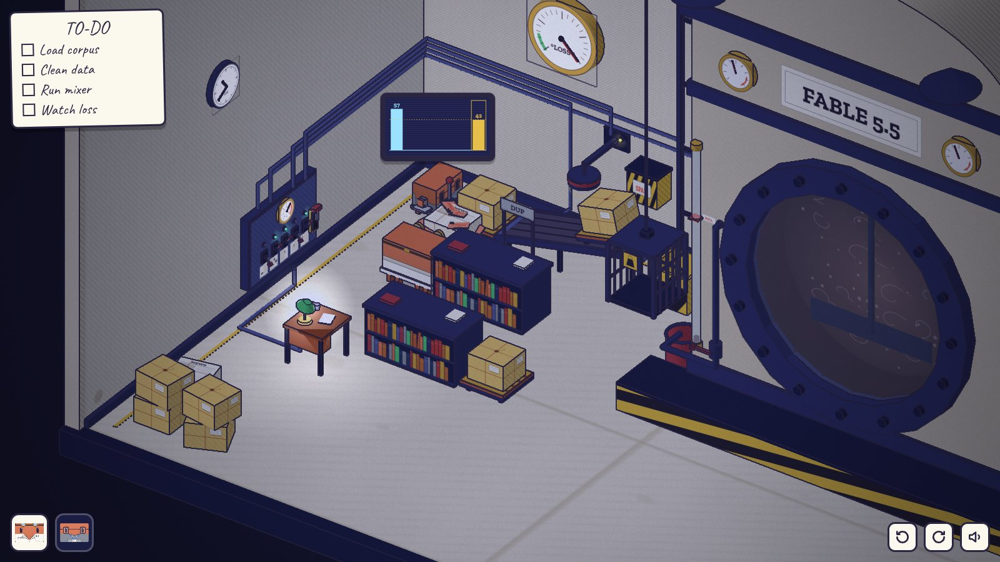

# 第一章 · 预训练 PRETRAINING

> 发布前 90 天 · 22:40。操控 Opus 和 Sonnet。代码在 [`src/diorama/ch1/`](../../src/diorama/ch1/)，自动通关测试是 [`tools/playtest-ch1.mjs`](../../tools/playtest-ch1.mjs)。



## 场景

还是那间实验室，只是早了 90 天：没有冷冻舱，没有 PLEASE DO NOT TAP THE GLASS 的牌子，后墙上写的是 CORPUS 而不是 CRYO BAY。

- **小图书馆**（以后放冷冻舱的地方）：两排低书架、一张阅读桌和桌上的台灯，四个带轮子的托盘。三个托盘上是牛皮纸包好的书捆，长得一模一样；一个是一捆报纸，里面夹着订书钉订住的粉红色 SPAM 传单。
- **后墙**：磅秤在左后角，传送带从磅秤往上斜着通到斗式提升机脚下。传送带上方挂着分拣磁铁，旁边墙上是黄黑的 SPAM 桶。磅秤前面的地上画着 DUP 停放格，挂着 DUP 牌子。墙上一只很大的 LOSS 表（夜光表盘）。
- **提升机**：斗子沿着塔架升到顶，倒进反应釜肩上的料斗。塔顶的绳轮另一边挂着配重笼，笼子平时吊在离地 0.6 的地方。
- **左墙**：配电箱。五个拨杆开关（上为开、下为关，上面各有一盏绿灯），下面各一块小图标牌，被墙漆糊掉了一半；一只安培表（0–6，4 以上是红区）；右边一个大的总闸手柄（上为合，跳闸时掉下来，露出红旗）。墙上的线管从配电箱出来，各走一层高度和深度，分别通到传送带电机、磁铁、提升机电机和搅拌机。台灯的电线沿地面走到桌上。钟在配电箱上方。
- **反应釜**：釜里是空的，舷窗后面只有浑浊和一根搅拌桨。釜正面左边一根液位管，刻着红色的 FULL 线；FULL 线的高度上接出一根管子，往下到一个球阀（撇料阀，手柄顺着管子是开、横过来是关），再拐到釜旁边的红色废料桶里。釜顶的搅拌机电机前面有一个飞轮，转起来看得见。

只有台灯亮着。

## 系统

| 用电器 | 电流 | 开关位置（从左到右） | 看得见的状态 |
| --- | --- | --- | --- |
| 搅拌机 | 4 | 1 | 舷窗里的搅拌桨在转，釜顶飞轮在转，低沉的轰鸣，釜上右边的仪表 |
| 传送带 | 2 | 2 | 皮带在走，尾部电机的绿灯，咔嗒声 |
| 台灯 | 1 | 3 | 灯亮，桌上一圈光 |
| 提升机 | 2 | 4 | 塔顶电机的绿灯 |
| 分拣磁铁 | 1 | 5 | 磁铁上的黄灯，磁铁下面一圈圈的黄色磁力线，嗡嗡声 |

- **配电**：总上限 4 A。超了，安培表指针甩进红区，冒火花，跳闸：全屋一黑，只剩舷窗后面若有若无的光（第一次跳闸时，里面还会传来一声闷响）。总闸只有在开着的东西加起来不超过 4 的时候才合得上，否则一合就打火花又掉下来。
- **重量**：托盘只有 Opus 推得动（推不动就拉）。配重笼要 Opus 坐进去才够重，Sonnet 太轻。
- **数据口**：磅秤西边有一个数据口。Sonnet 把电脑插上去，头顶会出现她的屏幕：已经送上传送带的每一捆一根青色柱子，柱顶写着重量；磅秤上正在称的那一捆是右边的黄色柱子，还有一条黄色虚线横过整个屏幕，方便比高低。SPAM 传单的重量是柱子顶上粉色的一截。
- **提升机**：开关每接通一次，提升机试着跑一趟。笼子里够重（Opus），斗子升到顶，倒进料斗，再降回来；不够重（空笼子或只有 Sonnet），电机憋住，斗子抖一下，指针甩到头，跳闸。
- **反应釜**：倒进去的每一捆让液面升一截（舷窗里的液面、液位管、釜上左边的仪表），浊液里漂着单词。三捆不同的正好到 FULL 线。混进了 SPAM，液面上漂着粉红色的纸片；同一捆书进去两次，浊液里的每个词都成双成对（the the、and and）。
- **训练**：搅拌机转着、釜里有料，LOSS 表往下落，钟往前走（LOSS 落多少，夜就过去多少）。干净又满：落到底，天亮。不满：落到一半多一点就不动了（料不够）。有脏数据：落到一半就卡住，指针在那里抖，钟也停了。

## 谜题链

1. **哪个开关管哪台机器。** 图标牌只剩一半，台灯亮着占了 1 A。一个个试，看安培表跳多少、谁动了、听声音；线管也能顺着找。最先试的往往是最左边那个（搅拌机 4 A），加上台灯就是 5，直接跳闸。
2. **清洗线要 3 A。** 传送带 2 + 磁铁 1 + 台灯 1 正好 4。
3. **称重和去重。** Sonnet 插上磅秤。Opus 把托盘一个个推到磅秤上（推箱子），拉动磅秤边上的进料杆，托盘连货一起滚上传送带。三个牛皮纸包一模一样，只有屏幕上能看出来：有两根柱子一样高（都是 42）。第二个 42 是重复件，把它从磅秤上拉下来，推到 DUP 格里。报纸那一捆经过磁铁时，粉红传单被吸起来，扔进 SPAM 桶，屏幕上它那根柱子顶上的粉色也没了（31 → 28）。
4. **配重笼。** 传送带把货倒进斗子。提升机要配重：Opus 坐进笼子。笼子在提升机旁边，配电箱在左墙，Opus 走不开，只能操控 Sonnet：去配电箱关掉传送带（腾出 2 A），打开提升机。斗子升到顶，倒进料斗，笼子沉到地面；Opus 在笼子里出不来，直到斗子降回来。
5. **搅拌一整夜。** 搅拌机 4 A，只能关掉别的一切，包括台灯。黑暗里只剩夜光的 LOSS 表和钟，钟飞快地转，LOSS 表一点点往下落。
6. **天亮。** LOSS 落到底，天光发白，浊液慢慢静下来，里面睁开一双琥珀色的眼睛。它在看 Opus。

## 恐怖与反转

眼睛睁开以后，Opus 还能走。很快就会发现，眼睛看的不是 Opus，而是**鼠标指着的地方**，而且比鼠标还快一点：它看的是鼠标正要去的地方（按指针的速度往前预判）。点一下地面，Opus 才开始走，眼睛早就在那里等着了。它在预测下一步。

走过两次以后（或者等一会儿），眼睛转过来，直直地看着屏幕外面的人。心跳三下，黑屏，第二章的标题卡。

TO-DO 清单：Load corpus / Clean data / Run mixer / Watch loss。釜里满了打第一个勾；满且干净打第二个勾；搅拌机带料转起来打第三个勾，同时圈出最后一项；天亮打最后一个勾。

## 错路和它们的反馈

| 错路 | 反馈 |
| --- | --- |
| 台灯开着去开搅拌机 / 开太多 | 指针甩进红区、火花、跳闸、全屋黑；总闸要先关掉点东西才合得上，硬合会打火花又掉 |
| 笼子空着开提升机 | 斗子抖一下，电机憋住，指针甩到头，跳闸；头上冒羽毛气泡（太轻） |
| Sonnet 坐进笼子再开提升机 | 同上，Sonnet 头上冒羽毛气泡 |
| 传送带开着、磁铁没开 | 报纸那一捆带着粉红传单进了釜：液面上漂粉红纸片，TO-DO 的 Clean data 不打勾，LOSS 卡在一半抖 |
| 不看屏幕，两个 42 都送进去 | 液面超过 FULL 线，浊液里的词成双成对，LOSS 卡在一半抖 |
| 料不够就开搅拌机 | LOSS 落到 0.8 或 0.62 就停，液位管在 FULL 线下面；点液位管冒“空杯”气泡 |
| 釜空着开搅拌机 | 桨在转，LOSS 不动，钟不动 |
| 传送带没开就拉进料杆 | 杆子咔一声，托盘不动 |
| Opus 去插数据口 | 头上冒电脑气泡（要 Sonnet） |
| Sonnet 去推托盘 | 太重的气泡 |

**脏数据怎么救（设计稿的“放掉一半，重来”）**：打开 FULL 线上的撇料阀，浮在上面的东西流进废料桶（粉红纸片、多出来的那一捆，也就是 FULL 线以上的部分），桶里能看到粉红的碎屑，液面回到 FULL。再开一次搅拌机，LOSS 接着往下落。如果液面还没到 FULL（比如只进了两捆，其中一捆带着 SPAM），阀门里什么都流不出来，要先把料加满。四个托盘总能全部送进去（见下面的证明），所以这条路总能救回来。

## 推托盘没有死局

托盘按 `CL.Moves.pushable` 的规则动：点哪一面 Opus 就站到那一面；那一边推得过去就推一格，推不过去就往回拉一格（要求 Opus 身后还有一格空地）。点托盘顶面时，按点的位置离哪条边最近算是哪一面（这样四个方向都能在默认视角下点到）。托盘只能停在整格的托盘地面上（左墙边的通道和 DUP 牌子下面有路沿挡着轮子，Clawd 可以走，托盘不行），Sonnet 只在这些通道上站着，挡不到托盘。

[`src/diorama/ch1/solve.mjs`](../../src/diorama/ch1/solve.mjs) 用同一套规则把从开局能到的所有局面都列出来（托盘位置、哪些已经送走、哪些称过、Opus 能走到哪片区域），一共 726 005 个，然后从终点往回搜：

- 任何一个局面都还能把 b、c 和 a / d 中的一个送上传送带，并且 Opus 还能走到配重笼前面（0 个死局）；
- 只要两个 42 没有都送进去，任何一个局面都还能干净地收尾：两个 42 都称过，一个送走，另一个停在 DUP 格（0 个死局）；
- 最短的干净解 24 步（推 / 拉 / 进料），测试就按这一条走。

```
node src/diorama/ch1/solve.mjs
```

## 可交互物（50 个左右，约三分之一是信息源）

- **操作**：5 个开关、总闸、磁秤数据口（Sonnet）、进料杆、4 个托盘（四个面 + 顶面）、配重笼、撇料阀、地面、反应釜前的平台、两只 Clawd（选人 / 叠罗汉）。
- **信息源**：安培表、5 块图标牌、5 盏开关绿灯、Sonnet 的屏幕、LOSS 表、液位管和 FULL 牌、舷窗（液面、单词、纸片、搅拌桨）、釜上两只仪表（左：液位，右：搅拌机）、釜顶飞轮、传送带（皮带和绿灯）、磁铁（黄灯和磁力线）、SPAM 桶（里面的粉红传单）、DUP 牌子、塔架和斗子、料斗、废料桶、钟、线管。
- **其他**：书架、阅读桌、台灯、传送带下面的空托盘、房间角落多出来的书捆、上锁的出口。

看东西（仪表、图标牌、舷窗、液位管、LOSS 表、SPAM 桶）时镜头会拉近；点别处就回来。

## 和设计稿的出入

- **搅拌机 4 A，不是 3 A。** 设计稿里搅拌机 3 + 台灯 1 = 4，并不超限，台灯就不必关。改成 4，搅拌机一个就顶满，台灯必须关，夜才是黑的。
- **放料阀改成 FULL 线上的撇料阀**，在釜正面，站在平台上就够得着（料斗在釜顶，够不着）。规则是“放掉浮在 FULL 线以上的东西”，而不是固定放掉一半；这样不会把干净的料一起放掉，也保证一定救得回来。
- **托盘连货一起滚上传送带**（托盘输送线），空托盘在传送带尽头掉到下面堆着。这样送走的托盘不会留在图书馆里挡路，推箱子的部分不至于太长。
- **Sonnet 不能拉托盘。** 设计稿说 Sonnet 可以拉轻的托盘；共用的推箱子规则（推不动就拉）已经保证不会卡死，所以只有 Opus 推拉。
- **提升机每接通一次跑一趟**，跑完停在底下；要再跑一趟就关了再开。这样“先让 Opus 进笼子、再让 Sonnet 去合闸”的配合是必须的：先开提升机再进笼子，会因为笼子是空的当场跳闸。

## 共用文件

没有改。新的气泡图形（电脑、羽毛、闪电、空杯）在 `art.js` 里画，包了一层 `CL.Tex.icon`；新的声音（跳闸、火花、憋住、咕嘟、心跳、黎明的和弦，以及传送带、磁铁、搅拌机、提升机的持续声）用本章自己的 WebAudio context，遵守全局静音。

## 测试

- `node tools/playtest-ch1.mjs [截图目录]`：真实点击通关。先故意开搅拌机跳闸、复位；开传送带和磁铁；Sonnet 插磁秤；Opus 按 24 步推完托盘，屏幕上出现第二个 42，把它停进 DUP 格；空笼子开提升机跳闸、复位；Opus 进笼子，Sonnet 合闸；关掉一切开搅拌机；天亮；鼠标移到两个地方，检查眼睛看的是鼠标；点地面走两次；等到第二章标题卡。
- `node src/diorama/ch1/solve.mjs`：推托盘没有死局的证明。
- 截图：`node tools/shoot3d.mjs out ch1/room ch1/panel ch1/dark ch1/lift ch1/night ch1/spam ch1/eyes`。

**测试钩子**：`tools/playtest-flow.mjs` 在第一章只点一下舷窗就等着下一章。为了让它继续能过，`?fast=1`（测试模式）下，如果本章的第一下点击就点在舷窗上，本章直接结束。正常游戏不受影响。等 flow 测试改用别的方式跳章，可以删掉（`play.js` 里搜 `test hook`）。

## 已知问题

- 低端机上 SwiftShader 很慢，长时间跑的测试要给足时间。
