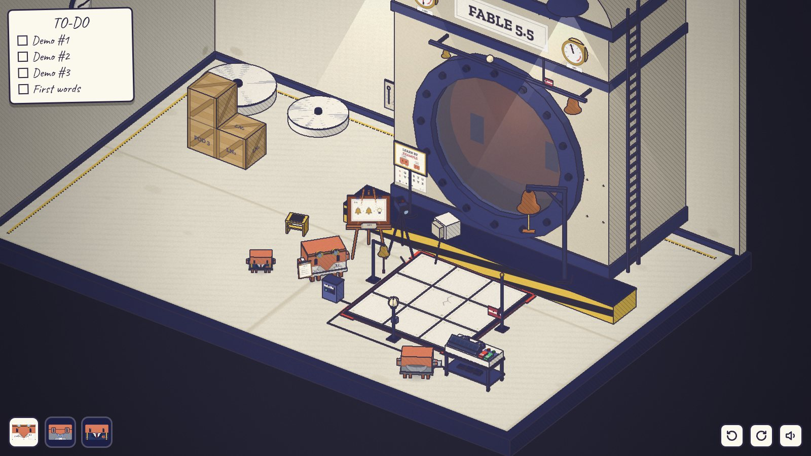
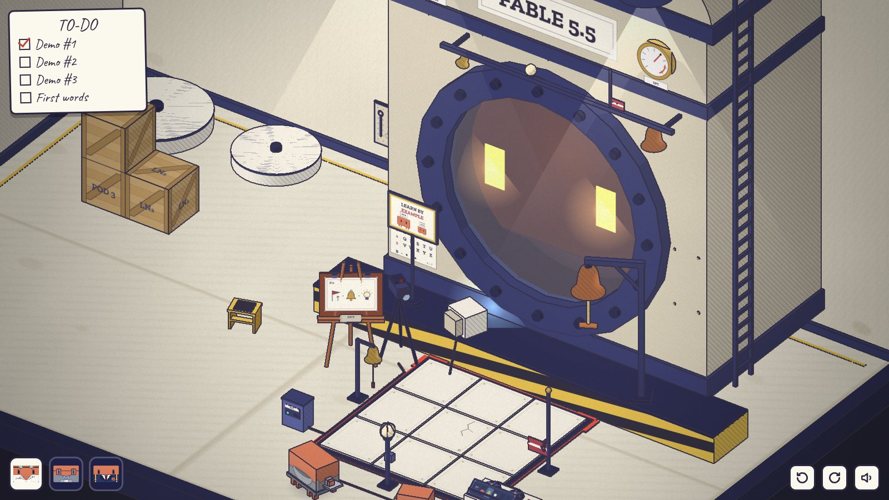
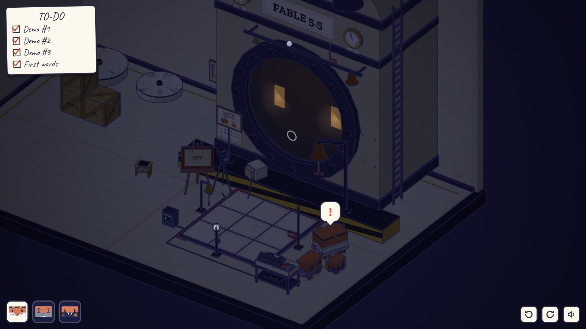
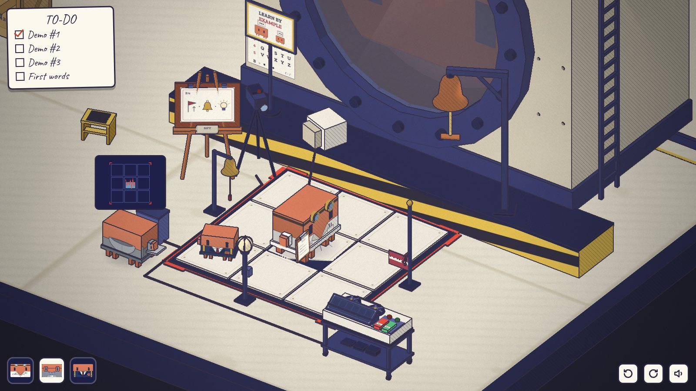
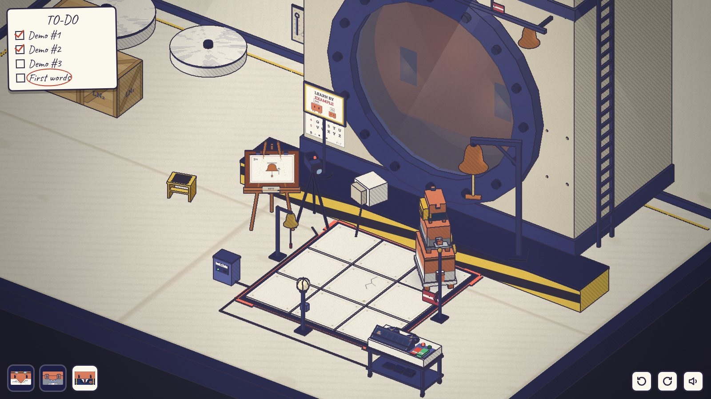
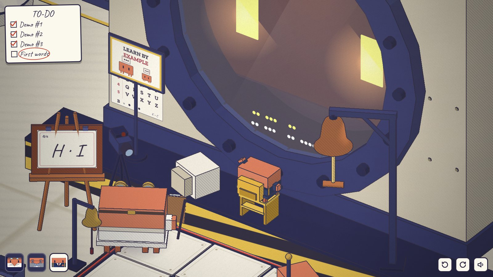

# 第二章 · 监督微调

> SUPERVISED FINE-TUNING · 发布前 60 天 · 09:15 · 操控 Opus、Sonnet、Haiku

文件：`src/diorama/ch2/`（`art.js` 图形、贴图、气泡、声音；`props.js` 模型；`level.js` 房间；`play.js` 规则），测试 `tools/playtest-ch2.mjs`，截图 `docs/diorama/ch2-*.jpg`。

| | | |
| --- | --- | --- |
|  |  |  |
| 早上的实验室：示范台、录像机、画架、踏凳 | PLAY：Fable 的眼睛亮起，用舷窗上方那一套照着做 | 下班关灯：玻璃里传来「笃、笃」 |
|  |  |  |
| Sonnet 插上数据口，中间那块砖的读数在乱跳 | 三只叠在舞台右后角拉大铃，清单挂在工具板上 | Haiku 敲 H · I，玻璃里面回敲同样的点 |

## 场景

白天，暖光。同一间实验室，60 天前：

- 冷冻舱还没装好：两个空底座，第三个舱还在木箱里（POD 3）。反应釜上还没有 PLEASE DO NOT TAP THE GLASS 的牌子，只有四个螺丝孔。
- 釜前（黄黑平台前面）是 3 × 3 块**示范地砖**，四周贴着红色胶带框，四角是取景框的折角。这就是「舞台」：后左角的三脚架摄像机拍的就是它。
- 舞台四边是**示范装置**：左边一只小铃（拉下面的红绳），前边一盏灯（按钮朝着舞台），右边一面旗（摇手轮旗子升起又落下），右后角平台上立着一根高杆，伸出一只**大铃**，铃绳的把手在 1.95 高。
- 舷窗上方的横杆上是 Fable 的**镜像装置**：同样的小铃、灯、旗、大铃，左右顺序也一样。
- 舞台右前方的推车上是**录像机**：两个卷盘、REC（红）和 PLAY（绿）两个键、一个「录像带窗口」，用图形列出录下来的每一件事。
- 平台左边一台小电视面朝舷窗，回放时亮起蓝光：Fable 看的就是它。
- 画架上是一摞**示范卡**，一张张翻。旁边一只黄色**踏凳**。
- 反应釜左下角贴着**敲击码表**（5 × 5，K = C，行号在左，列号在上，下面一行示例：B = ● ●●）。平台上一个海报架（LEARN BY EXAMPLE）正好挡住了表的上面三行。
- 舞台左前方一个 **DATA 接线盒**，是地砖的数据口。后墙上一块**工具板**，画着工具的轮廓，其中一个是清单夹的轮廓，上面一个空钩子。
- 釜上两块表贴了标签：LOSS 和 SFT。每过一张卡，LOSS 降一点，SFT 升一点。

## 规则（系统）

- **录像**：按 REC 开始录（旧的录像清掉），舞台红框开始闪，摄像机红灯亮，卷盘转。只有站在舞台上（看叠罗汉最底下那只）做的事才会被录下；在舞台外做的事，录像带窗口里什么都不会出现。按 PLAY 停止录像并回放。Haiku 太矮，够不着录像机的键。
- **Fable 照做**：回放时 Fable 的眼睛亮起，按录像的顺序用镜像装置做一遍。和卡片完全一样，卡片翻过去；不一样，蜂鸣，旁边的 Clawd 冒出一个图形说明哪里不对。
- **压板**：地砖是压板，Opus 和 Sonnet 站上去会往下沉一点；Haiku 太轻，压不动。
- **松动的砖**：中间那块砖松了（细看有裂纹）。Opus 或 Sonnet 踩上去，咔哒一声，砖晃一下、起一点灰。录像时这一声也录进去。Fable 学到的是「每个动作之前都要咔哒一声」：录像里只要有一声咔哒，它在每个动作前都咔哒一声。Haiku 踩上去没有声音。
- **Opus 的习惯**：Opus 闲着站一会儿（约 4.5 秒；底下扛着别人时更快，约 1.6 秒），就会用笔在清单上敲两下，「笃、笃」。在舞台上录像时，这两下也会被录下，Fable 也会照着在玻璃里面敲两下。把清单挂到工具板的钩子上，他就没东西可敲了（再点一次钩子拿回来）。
- **数据口**：Sonnet 插上 DATA 接线盒，头上出现电脑屏幕：3 × 3 格子显示每块砖上的重量（Haiku 不显示，太轻），中间那格是一条红色的乱跳折线。别的 Clawd 点它，只会想到「需要电脑」。
- **踏凳**：Opus 或 Sonnet 点踏凳把它抱起来，再点地面或平台就放到那里。只有 Haiku 站得上去（点踏凳就爬上去）。
- **敲击码**：只有 Haiku 的小指节敲在玻璃上声音清脆。Opus、Sonnet 敲是一声闷响，他们会想到「要小的那只」。Haiku 要站在平台上的踏凳上（或者叠在别人身上）才够得着玻璃。点一下玻璃敲一下；停 1.5 秒算一组；每敲一下玻璃上留下一个白点，组和组之间空开，所以敲了什么一眼能看出来。敲满四组，或者停 4.5 秒，Fable 就从里面把听到的原样敲回来（琥珀色的点）。

## 谜题链

### 1. 铃、铃、灯（教学）

卡片 1/4：🔔 · 🔔 · 💡。按 REC，在舞台上拉两下小铃、按一下灯，回到录像机按 PLAY。Fable 用舷窗上方那一套做一遍，卡片翻过去。

要想的：卡片是「要做的事」；录像机两个键；舞台的红框和摄像机是「被录的范围」（按 REC 时框会闪）。

### 2. 旗、铃、灯（它连错也学）

卡片 2/4：🚩 · 🔔 · 💡。旗在右边，铃在左边，从旗走到铃，最直的路正好踩过中间那块松砖。

- 错路：Opus 一个人做。录像带窗口里在旗和铃之间多了一个红色的「咔哒」图形。回放时 Fable 在**每个**动作前都咔哒一声（Fable 做的是：咔哒 旗 咔哒 铃 咔哒 灯），整个反应釜震一下。卡片不翻，Clawd 想到一块晃动的砖。
- 找砖：踩上去会响、会晃、会起灰；Sonnet 插数据口能看到中间那格在乱跳；细看砖面有裂纹。
- 解法（任选）：
  - 让 Haiku 去做（太轻，砖不响）；但 Haiku 够不着录像机，要 Opus 或 Sonnet 在舞台外按 REC 和 PLAY；
  - 绕开：先走到前排或后排的砖，再去另一边；
  - 分工：一只守在旗边，一只守在铃边，谁都不穿过中间。但守在舞台上的 Opus 一闲下来就会敲清单（见第 3 步），这条路会撞上下一个问题。

### 3. 大铃（三只都得站在舞台上）

卡片 3/4：大铃（带绳子和向上的箭头）。铃绳把手在 1.95 高，挂在舞台右后角。

- 够不着：Opus 1.2，Sonnet 站 Opus 头上 1.78，只有三只按大小叠起来（Opus、Sonnet、Haiku）在舞台上才够得到（2.18）。Haiku 站踏凳上也只有 1.1。点不到就冒「向上」的图形。
- 错路 1：在平台上叠罗汉。平台高 0.56，两只叠就够得到绳子，也拉响了，可是平台不在舞台的框里：录像带窗口里什么都没多。回放时 Fable 什么都没做，Clawd 想到取景框（四个红折角，旁边一个小方块在框外）。
- 错路 2：在舞台上叠好了，Opus 在最底下等着，扛着人等得更不耐烦，很快就「笃、笃」敲清单。录像里多了这两下，Fable 也在玻璃里面「笃、笃」。Clawd 想到清单和笔；Opus 自己也会想到清单。
- 解法：Opus 去工具板，把清单挂在那个画着清单轮廓的钩子上；按 REC；走到舞台右后那块砖（录像机在右前方，这一路不经过松砖）；Sonnet 爬上 Opus，Haiku 爬上 Sonnet，Haiku 拉绳；Opus 扛着两只走回录像机按 PLAY。

### 4. H · I

卡片 4/4：手写的 H · I。录像机在这里没用（按 PLAY 只会让 Clawd 想到「看卡片」）。

- 敲击码表在反应釜左下角，但正面看过去，海报架挡住了上面三行，只看得到 QRSTU、VWXYZ 和示例「B = ● ●●」。按 Q 转到侧面，海报和表之间的距离错开，整张表都露出来：第 2 行是 FGHIJ。也可以推出来：25 个字母去掉 K，前三行就是 ABCDE FGHIJ LMNOP。
- 先行后列（示例：B 是 1 下、停、2 下）。H = 2 下、停、3 下；I = 2 下、停、4 下。
- 谁来敲：Opus、Sonnet 敲是闷响，留不下点，他们想到「小的那只」。Haiku 自己站在平台上够不着（向上的图形）：要把踏凳搬到平台上舷窗前面（Opus 或 Sonnet 抱过去），Haiku 爬上去。叠在 Opus 身上也行。
- 错路：先列后行，敲 3、2，玻璃上的点是「●●● ●●」，Fable 原样敲回来，卡片不翻，Haiku 冒问号，几秒后点被擦掉，可以重来。
- 对了：Fable 从里面敲回「●● ●●● ●● ●●●●」，眼睛亮了，大家冒爱心，最后一张卡翻过去，清单打满勾。

## 恐怖与反转

下班。钟一下子转到傍晚，三只从凳子上、从彼此身上下来，走到门口。灯一盏盏关掉，房间暗下来，只剩舷窗里一点暖光。

停了一会儿。

黑暗里传来两声轻轻的敲击：「笃、笃」。和 Opus 用笔敲清单的声音、节奏一模一样，玻璃上荡开两圈光。Opus 站着没动，清单可能还挂在墙上的钩子上。他转过身，冒出一个感叹号，然后想到清单。

它学会的不只是你想教的东西：录像里有没有那两下都一样，它一直在看。

## 象征

| 东西 | 意思 |
| --- | --- |
| 示范卡、录像、舞台 | 监督微调的示范数据 |
| 松动的砖、敲清单的节奏 | 示范数据里的噪声；模型照单全收，还会泛化（一声咔哒变成每个动作前都咔哒） |
| 取景框 | 只有进入数据集的才算数 |
| LOSS / SFT 表 | 训练损失下降、对齐示范的程度上升 |
| 黑暗里的「笃、笃」 | 模型学到的远不止标注者想教的 |

## 可交互物（32 个，信息源 16 个）

控制（13）：REC 键、PLAY 键、小铃、灯、旗、大铃绳、踏凳（抱 / 放 / 爬）、工具板的钩子（挂 / 取清单）、DATA 接线盒（Sonnet 插电脑）、玻璃（敲）、地面、舞台的 9 块砖（走；中间那块会响）、平台（走、放踏凳）。

信息源（16）：录像带窗口（录像机本体）、三脚架摄像机（红灯）、画架上的卡片和剩下的卡、敲击码表、海报、大铃本身、Fable 的小铃 / 灯 / 旗 / 大铃（各自点开，Clawd 冒出对应的图形）、Fable 的横杆、电视、LOSS 表、SFT 表、钟、空的舱底座。

其他：出口（还没到下班时间，冒钟的图形）、木箱（太重）、三只 Clawd（选择、爬到头上）。

信息源点下去，镜头会凑近去看；再点别的地方或换角色就回来。Haiku 站上舷窗前的踏凳、或开始敲玻璃时，镜头也会凑近玻璃，方便看清敲出来的点。

## 状态一眼可读

- 录像：REC 键按下去不弹起、红灯亮、卷盘转、舞台红框闪、摄像机红灯亮、录像带窗口右上角红点。回放：PLAY 键按下、绿灯亮、电视亮、Fable 眼睛亮，录像带窗口里正在做的那一格亮起。
- 小铃、灯、旗、大铃都是一下一下的动作，没有开关状态；旗升起后自己落回原处。
- 清单在 Opus 手里还是挂在钩子上，看得见。踏凳在哪儿、谁站在上面，看得见。
- 敲击：每一下都在玻璃上留一个白点，分组空开；Fable 回敲的是琥珀色的点。

## 不会卡死

- REC 随时可以重录（回放和 Fable 回敲时键锁住，冒 zz）。
- 踏凳只能放在空地上（自动找最近的空位），Opus 或 Sonnet 随时能再抱起来；有人站在上面时抱不动（问号）。
- 叠罗汉随时可以拆：点地面就跳下来。
- 敲击码每敲完一次，几秒后点会擦掉，可以重敲。
- 清单可以挂上也可以取回。

## 和设计稿的出入

- 设计稿只有「铃、灯、旗」和「高处的铃绳」。这里把高处的铃做成单独的一只大铃（卡片上有绳子和向上的箭头），镜像装置也多一只大铃。
- 「录音」做成了摄像机加录像机：舞台的红框就是摄像机的取景框，这样「站在舞台外就录不全」有了看得见的理由。回放给 Fable 看的电视放在平台上，面朝舷窗。
- 海报不是贴在表上，而是平台上的一个海报架，离表有一段距离，转视角时两者错开（视差），所以转一下就能看到被挡住的行。挡住的是上面三行，不只一角。
- 敲击码的分组靠停顿（1.5 秒），玻璃上的白点就是记号。只有 Haiku 敲得响（小指节），所以 Haiku 必须是敲的那只。
- Opus 的习惯在任何地方都会出现（闲着就敲），只有在舞台上录像时才进录像。设计稿说「Fable 也学会了」，这里由第 3 步一定会遇到：扛着人的 Opus 很快就会敲。
- 第 2 步加了「分工」和「绕开」两种解法，Haiku 不是唯一答案。
- 结尾 Opus 先想到的是自己的清单：有时候它还挂在墙上。

## 共用文件

没有改动。只在运行时扩展：

- `CL.Tex.icon(kind)`：包了一层，新增气泡图形 click / tile、taptap / clip、frame、bell、big、lamp、flag、knock、card、clock、laptop，其他 kind 原样交给原函数。
- `CL.Sound.play(name)`：包了一层，新增 ding、dingF、bong、bongF、clack、tok、flick、crank、key、whirr、buzz、flip、yes、knock、knockF、thump、lift。用本章自己的 AudioContext（共用的那个是私有的），跟随 `CL.Sound.muted`，页面没有过用户操作时不创建。
- 后期色调 `world.pipe.post.uniforms.uTint / uTintA` 设成暖色（每章新建 world，不影响别的章节）。

## 已知问题

- 舞台右后角的大铃杆和左后角的摄像机，从默认视角看会挡住一点点平台和舷窗下沿；转视角可以看清。
- 寻路是格子 A*，自动选路。录像机放在舞台右前方，就是为了让「去按键、去拉绳」这些自动走的路都不经过中间那块松砖；只有从旗走到铃（第 2 步要的陷阱）、或者玩家自己点了中间，才会踩到。从录像机走去后墙的工具板会经过它，但那时一般不在录像。
- 敲击码的分组按游戏内时间计算；在很慢的机器上（每帧被截到 0.05 秒），实际停顿会比 1.5 秒长一点。
