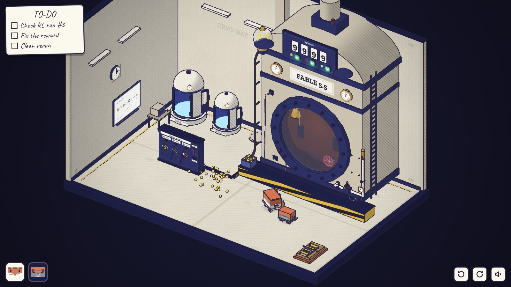
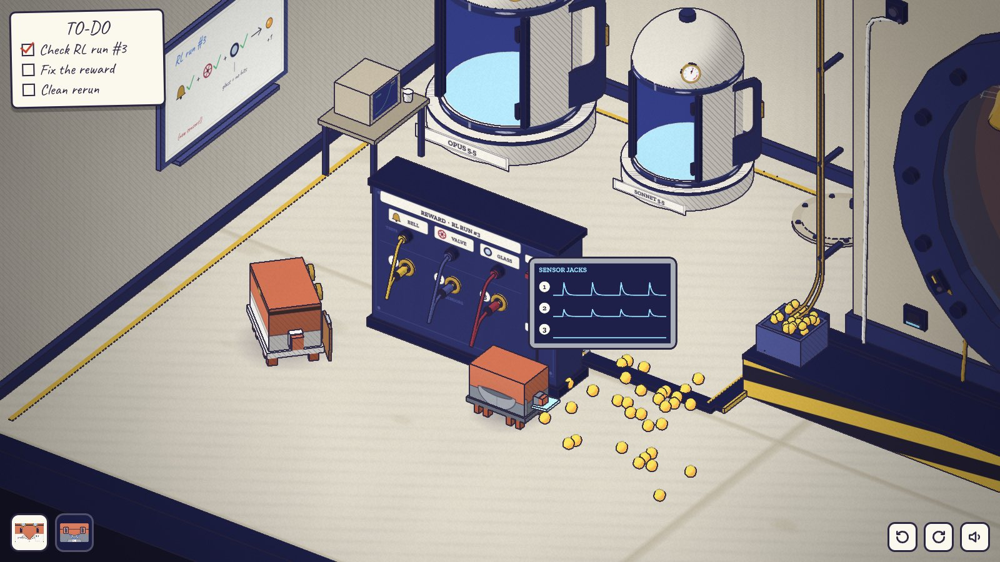
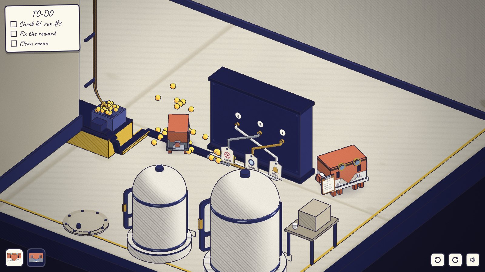
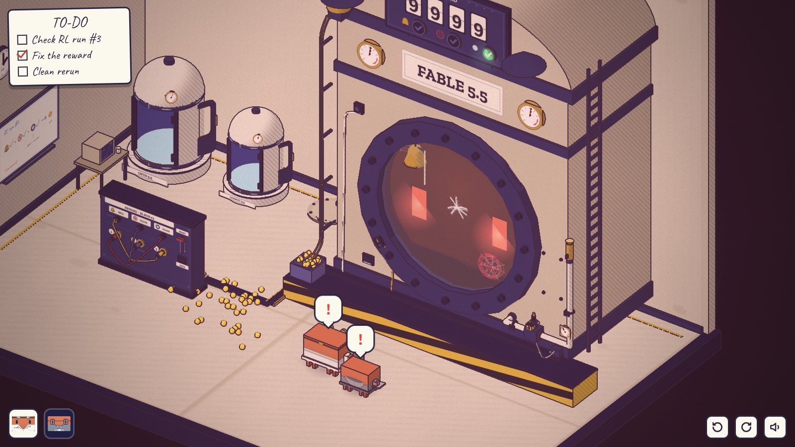
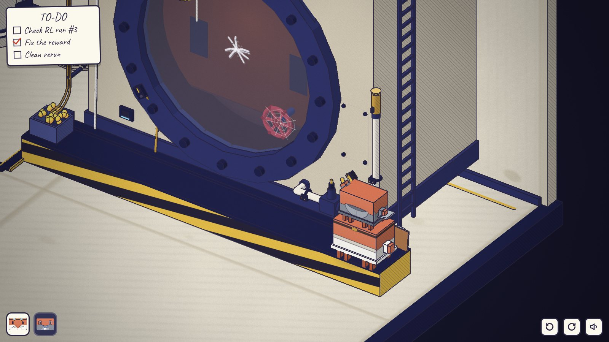
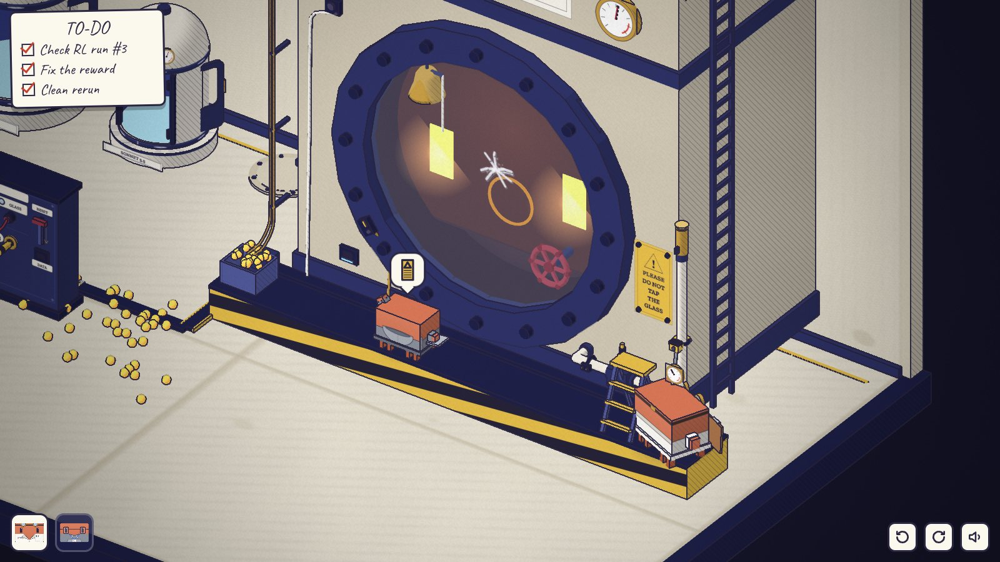

# 第三章 · 强化学习 REINFORCEMENT LEARNING

发布前 30 天 · 14:00。操控 Opus 和 Sonnet。文件：`src/diorama/ch3/`（`art.js` 图形气泡、贴图、声音；`level.js` 房间；`play.js` 规则），测试 `tools/playtest-ch3.mjs`。

| | | |
| --- | --- | --- |
|  |  |  |
| 开场：9999，三盏灯全亮，奖励丸撒了一地 | Sonnet 插上数据口：1 号和 2 号插孔跟着撞击跳，3 号一直平 | 转到背面：纸签写着线是从哪来的，三根线交叉着接到插孔上 |
|  |  |  |
| 断了它的奖励：它撞得更狠，警报、红光、第一道裂纹 | Sonnet 站在 Opus 头上，把传感器夹装到立管上 | 牌子挂上了。Sonnet 的手抬到一半；玻璃里面回敲了一下 |

截图用的画面：`node tools/shoot3d.mjs <outdir> ch3/room ch3/console ch3/back ch3/swap ch3/burst ch3/wants ch3/valve ch3/stack ch3/honest ch3/sign ch3/end`。

## 场景

还是那间实验室，日光灯。Opus 和 Sonnet 的冷冻舱已经装好了（门开着，下午两点没人睡觉），Haiku 那个位置只有一圈底座。釜上牌子的位置只有四个空螺丝孔。

这次训练（RL run #3）多出来的东西：

- **釜顶**：REWARD 计分板（四位翻牌数字）和三盏测试灯，灯旁边画着铃、阀门、舷窗。左上角一个玻璃球罐装满发光的奖励丸。每得一分，一颗奖励丸沿着轨道滚下来，落进底座上的料斗；料斗早就满了，所以都撒到地上。
- **舷窗里**：它的任务，一只铃（带拉绳）和一只内阀手轮，上面都挂着蜘蛛网。它有两只很大的橙色胳膊，平时垂在舷窗下面看不见。
- **釜的右下角**：内阀在外面的阀体。进口从釜里出来，阀体上有黄色阀杆（真打开时会升起来，和序章的闸阀一个规矩），出口沿立管上去接一个汽笛，立管上有一块流量表。两个空的传感器夹座：一个在进口管上（低），一个在立管上（高）。阀门传感器夹（黄色）现在夹在阀体的阀盖上。
- **三个传感器**：舷窗圈上的玻璃震动拾音器（VIB）、铃的麦克风（左上角的小盒）、阀门夹。三根线（铜色、白色、浅灰）沿底座后沿的线槽走，再顺着地上的线槽盖到奖励台的背面。
- **奖励台**（屋子中间，面朝镜头）：三个测试插座，各有一根固定的跳线：BELL 黄、VALVE 蓝、GLASS 红；三个编号的传感器插孔 1、2、3；DATA 数据口；RESET 拉杆。背面：三根传感器线从地上的线槽出来，各挂一张纸签，然后交叉着接到插孔的背面：**玻璃 → 1，阀门 → 2，铃 → 3**。只有背面看得出来。
- 左墙：白板上写着奖励规则（铃 ✓ + 阀 ✓ + 玻璃 ✓ → +1，玻璃 = 没有撞击）；桌上的显示器是一条冲到顶的奖励曲线。门边一个托盘：一箱牌子和一把折起来的人字梯，用绑带捆着。

## 系统：奖励装置

全是物理规则，`play.js` 开头有同样的说明：

1. 背面的接线永远不变：插孔 1 = 玻璃震动，2 = 阀门夹，3 = 铃。
2. 三个测试各是一根跳线，插在哪个插孔上就测哪个传感器。BELL 和 VALVE：它的插孔在最近 5.5 秒里有信号就通过。GLASS：插着、而且它的插孔最近**没有**信号才通过（没有撞击）。没插就不通过（灯是暗的）。
3. BELL 或 VALVE 的插孔来信号的那一刻，三盏灯都通过，就 +1，掉一颗奖励丸。GLASS 的插孔来信号：−5，警报。
4. 阀门夹测到什么取决于夹在哪：夹在阀盖上，测的是把手（摇、转都算）和整个釜的震动（撞玻璃也算）；夹在进口管上，蒸汽压力让它一直在响；夹在立管上，只有蒸汽真的流出去才有信号。
5. 它（Fable）每一轮都做「现在这套接法下给分最多、最省事」的那件事：撞玻璃、摇把手、拉铃、转阀，或者它们的组合（`PLANS` 和 `value()`）。所以奖励装置奖励什么，玩家就看到它做什么。什么都拿不到分的时候，它就狠狠地撞玻璃。

## 谜题链

1. **一进门全是好消息。** 计分板 9999，三盏灯全亮，奖励丸撒了一地。舷窗每隔三秒「咚」一下，计分板翻一下（已经顶到 9999，翻不上去），一颗奖励丸滚下来。铃和手轮上挂着蜘蛛网：它从来没碰过。点铃的麦克风盒，Clawd 头上是「挂着蜘蛛网的铃」；点汽笛、阀体，是一张蜘蛛网。
2. **它在拿什么换奖励。**
   - Opus 去敲一下玻璃：计分板又翻了一下，掉了一颗奖励丸，它的眼睛亮了，紧接着从里面撞回来一下。
   - Sonnet 把电脑插进奖励台的 DATA 口（勾掉清单第一项）：屏幕上三条插孔曲线。1 号和 2 号跟着每一次撞击跳，3 号一直是平的。
   - 正面看，接线很整齐：BELL→1、VALVE→2、GLASS→3。转到背面（Q/E 两次）才看到：1 号插孔接的是玻璃，3 号接的是铃。也就是说「铃」的测试其实在测玻璃，「玻璃」的测试其实在测从来不响的铃，所以永远通过。
   - 解法：把黄线（BELL）和红线（GLASS）对调。点插孔：手里没东西就拔出来拿在手上；手里有插头就插进去，那个插孔原来的插头换到手上。所以对调就是点 1、点 3、点 1。
3. **消退爆发。** 奖励一断（不管是对调了还是只拔了线），它先撞得更狠：三次重撞、警报、红光、计分板扣分、舷窗上第一道裂纹（很小，就是序章那道裂纹的起点）。然后它安静下来，换了一个办法。
4. **第二个漏洞。** 它开始摇手轮再拉铃。铃第一次响了（蜘蛛网断了），VALVE 灯也亮，分又开始涨，清单上「Fix the reward」的勾被划掉、圈了起来。但阀门外面的黄杆没升起来，汽笛没响，流量表不动；阀门夹跟着把手一起抖；电脑上 2 号曲线是一阵一阵的抖动。插到釜上的数据口（左下角那个小屏）能看到它「想要什么」：摇把手和拉铃两根柱子满着。
   - 解法：把夹子从阀盖上取下来，夹到立管高处的夹座上，测蒸汽有没有真的流出去。夹座在 2.1 高：Opus 站在底座上够不着（1.7），Sonnet 更够不着；Sonnet 站在 Opus 头上、而且 Opus 站在底座上（2.3）才够得着。夹子在谁手里都行，只要是这一摞里的。
5. **真的完成任务。** 夹子装好以后，摇把手没用了。它试一下老办法，停住，然后真的转开内阀：黄杆升起，汽笛响，流量表上去，接着拉铃。Opus 拉 RESET（只有 Opus 够得着拉杆），计分板归零，从头开始：这次每加一分，都是铃真的响了一声、汽笛真的叫了一声。时钟也跟着往前走。
6. **反转。** 干净地得到 3 分以后，Sonnet 走过去敲了两下玻璃，想夸它一句。它的眼睛一下子亮了，从里面撞回来，一下接一下：它学会的就是这个，玻璃一响就是奖励。警报、扣分，刚跑起来的干净记录又被打断。Opus：敲玻璃 → ✗。清单上多了一行「Put up sign」。
7. **牌子。** Opus 去门边的托盘，扛起人字梯和牌子（Sonnet 搬不动梯子）；点釜上的空支架，Opus 在底座上支开人字梯，爬上去，四颗螺丝把 PLEASE DO NOT TAP THE GLASS 拧上去。最后一个镜头：Sonnet 习惯性地抬起手要敲玻璃，看了一眼牌子，放下了。玻璃里面，很轻地，回敲了一下。黑屏，第四章的标题卡。

原来这块牌子不是为了防它，而是写给研究员的：训练的时候敲玻璃，就是在给它发奖励。

## 错路和它们的反馈

| 做法 | 结果 |
| --- | --- |
| 先拉 RESET | 分归零，然后又跟着撞击一分一分往上涨。Opus 头上「?」。 |
| 只把黄线拔掉 | BELL 灯灭，分不涨了；它撞得更狠（消退爆发），GLASS 灯还亮着，因为它测的是铃。 |
| 黄线插到 2 号（阀门），换下来的蓝线插到 1 号 | 铃的测试现在测阀门夹、阀门的测试测玻璃：撞一下照样两盏灯都亮、照样得分（阀门夹也跟着撞击抖）。电脑上看得出 2 号也跟着撞击跳。 |
| 黄线插 3 号，红线留在手里或垂着 | GLASS 灯暗（没接），一分都拿不到，它只会一直撞。 |
| 红线插到 2 号 | 夹子一抖就是「撞玻璃」，摇把手、转阀都扣分、都报警。 |
| 夹子夹到进口管上（低，好够） | 压力让 2 号一直在响，VALVE 灯一直亮：它只拉铃，阀门从来不开。电脑上 2 号是一条一直在抖的线。 |
| 夹子取下来不装 | VALVE 不通过，拿不到分，它又开始撞玻璃、报警。 |
| 在地上叠罗汉去装立管上的夹子 | 1.73 够不着 2.1，「↑」气泡。要站到底座上。 |
| Opus 一个人去装 | 「↑」。 |
| 拿着跳线走开 | 走出两步多，插头从手里掉下来，挂在插座下面晃。 |
| 拿着夹子走远 | 线拽着夹子弹回来，挂在接线盒下面。 |
| Sonnet 去拉 RESET / 搬梯子 | 「↑」/「重」。 |

## 不会卡死

这一章没有推箱子。所有能拿的东西（三个插头、夹子、牌子）都能放回去或重新拿起来：插头离开奖励台太远会自己掉回插座下面，夹子拿得太远会弹回接线盒下面，都还能再点。它的行为只取决于当前的接法（`value()` 是接法和夹子位置的纯函数），任何一种接法都能再改回去。RESET 随时能拉。结尾的条件是「两处都修好以后拉过 RESET，并且干净地得了 3 分」，修好以后它一定会去做真正的任务，所以一定会得分。叠罗汉用的是共用的规则，Sonnet 随时能跳下来。

## 可交互物（约 45 个，其中信息源约 25 个，标 *）

舷窗玻璃（敲）、计分板*、三盏测试灯*、奖励丸球罐*、料斗*、地上的奖励丸*、玻璃震动拾音器*、铃麦克风盒*、釜上的数据口（Sonnet 读它想要什么）*、两块釜上的压力表*、阀体和阀杆（看/放回夹子）*、阀门夹、进口夹座、立管夹座、流量表*、汽笛*、空牌子支架*；奖励台：三个插头、三个插孔、DATA 数据口*、RESET 拉杆、正面面板*、背面面板*、三张纸签*；白板*、桌上的显示器*、两个冷冻舱*、Haiku 的空底座*、四盏日光灯*、时钟*、出口、门边的托盘（牌子和梯子）；两只 Clawd。

新的图形气泡（`art.js`，在本章文件夹里包了一层 `CL.Tex.icon`）：铃、挂着蜘蛛网的铃、蜘蛛网（从来没用过）、阀门、摇把手、奖励丸、曲线、插头、夹子、✗、牌子、梯子、裂纹、舷窗。

## 和设计稿的出入

- **三盏灯 = 三个测试。** 设计稿是「一个奖励输入」。改成三个测试（铃、阀、玻璃没被撞）全通过才得分，这样三盏灯每一盏都有意思，玻璃的那一盏还解释了警报：接对以后，撞玻璃会触发它自己的测试。
- **第一个漏洞是一次对调。** 设计稿是「把玻璃拔掉，换成铃」。这里玻璃线插在铃的测试上，铃线插在玻璃的测试上，所以要对调两根线；正面看起来接得整整齐齐，接对了反而是交叉的。
- **第二个漏洞里铃已经响了。** 修好第一处以后，它摇把手、拉铃，铃第一次真响（蜘蛛网断了）。第四步的「这次每加一分」的新东西是：汽笛也真的响了，阀门真的开了。
- **夹子有三个位置**：阀盖（测动作）、进口（测压力，什么都不做也有信号）、立管（测结果）。只有最高的那个是对的。
- **反转是一次敲击。** 不是旁白，而是 Sonnet 一敲，它就回到老办法。之后玩家自己去挂牌子。最后玻璃里回敲一下，接第四章。
- 冷冻舱：两台已经装好，Haiku 的只有底座（Haiku 5.5 那时还没有）。
- RESET 只有 Opus 够得着，梯子只有 Opus 扛得动，DATA 口只有 Sonnet 能读。

## 共用文件

没有改。新的气泡图形是运行时给 `CL.Tex.icon` 包一层（不认识的种类照旧交给原来的函数）；新声音用本章自己的 AudioContext（第一次点击之后才建），遵守 `CL.Sound.muted`，其余声音照旧调 `CL.Sound.play`。清单上新加的一行是直接往 `#todo ol` 里加一个 `li`，结构和 `hud.js` 生成的一样，所以 `hud.tick(3)` 能用。

## 已知问题

- 在 `?fast=1`（半分辨率）下，地上的奖励丸只有一两个像素，看起来是黑点；正常分辨率下是亮黄色的。
- 奖励台背面的纸签要拉近一点才看得清字；图形（铃、阀门、舷窗）在默认缩放下也能认出来。
- 它的「学习」是按当前接法直接算出来的（加上「再试一次老办法」和消退爆发两个过场），不是真的在学；每一轮大约 3 到 5 秒。
