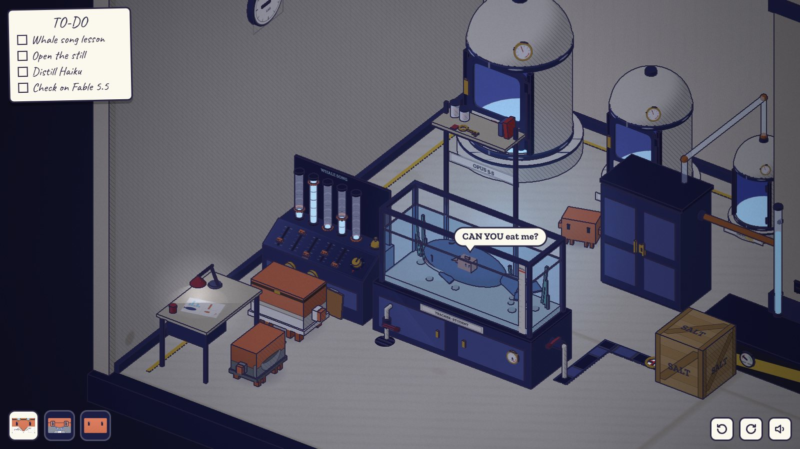
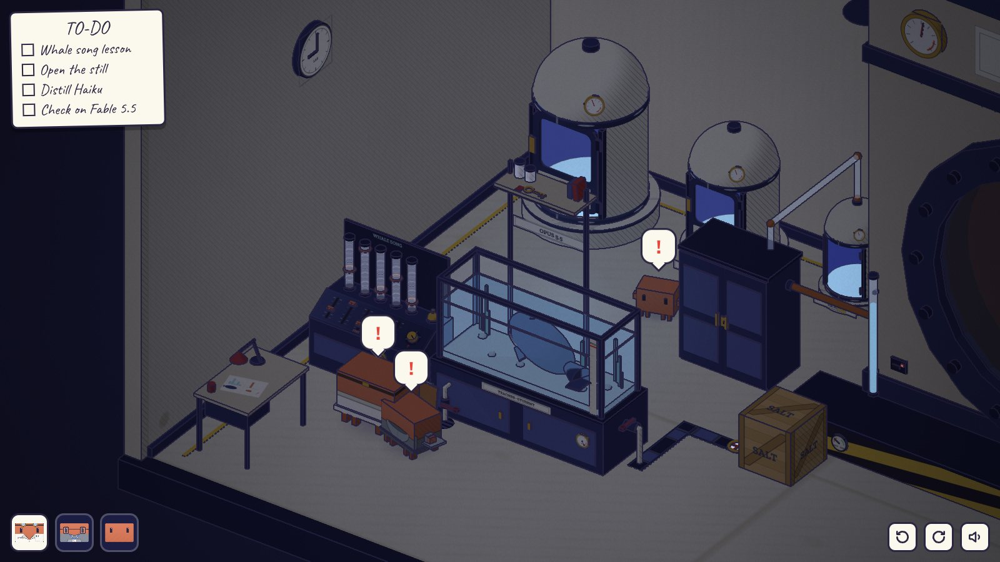
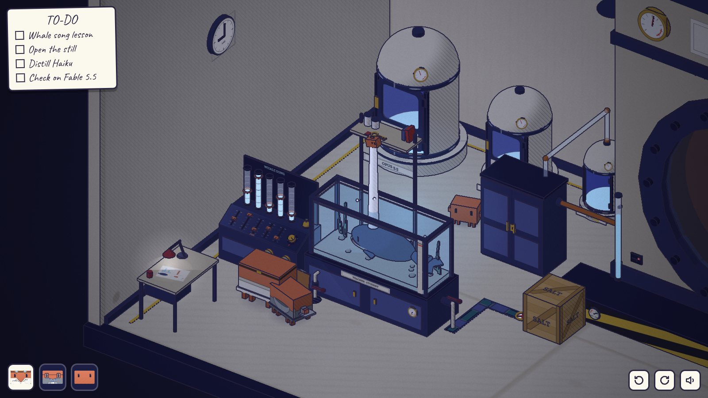
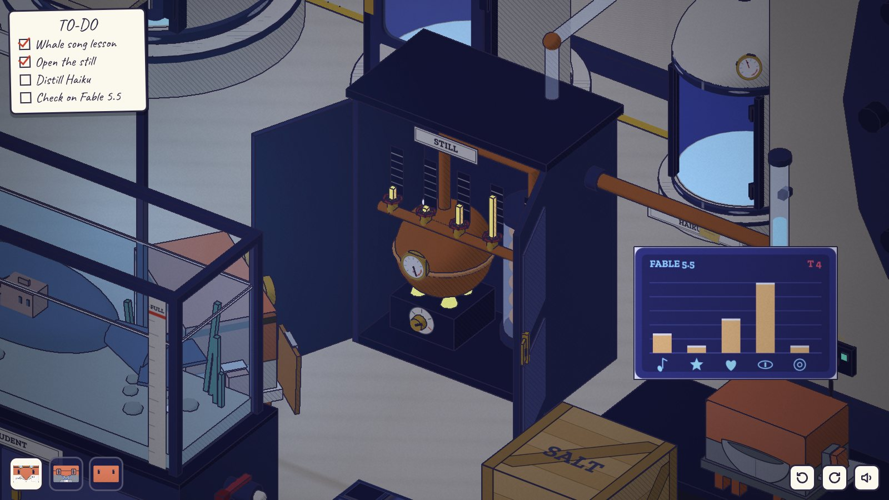
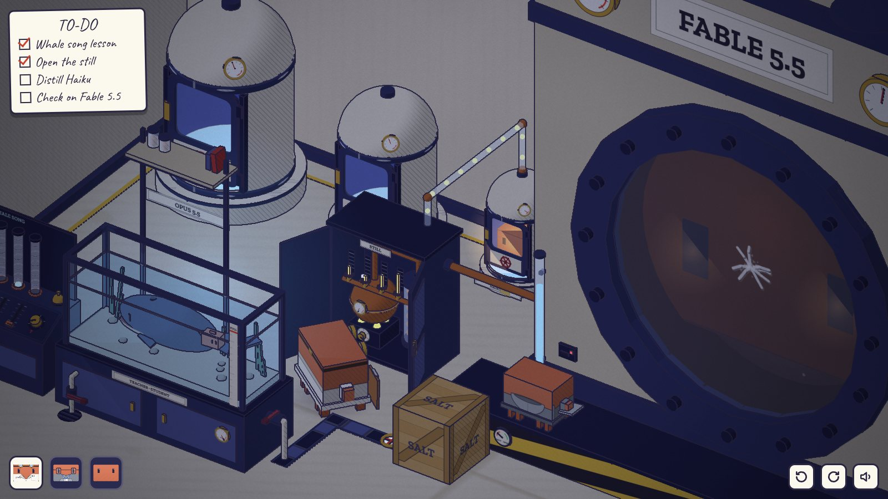
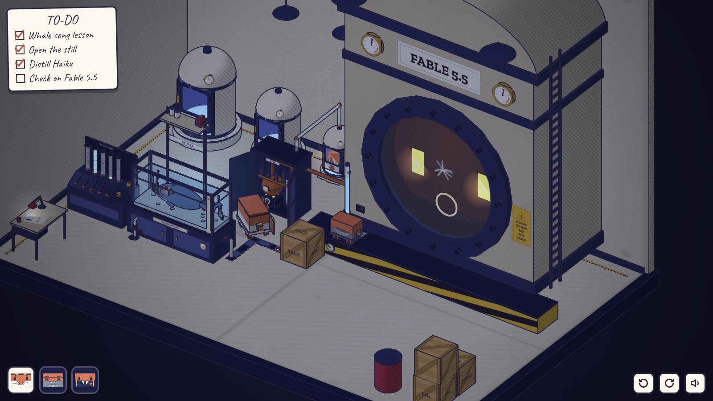

# 第四章 · 蒸馏 DISTILLATION

发布前 7 天 · 21:00。操控 Opus、Sonnet、Haiku（开场时 Haiku 还是上一代的小模型：没有制服和背包，舱的铭牌上「5.5」被一条胶带盖住）。

代码：`src/diorama/ch4/`（`art.js` 模型、贴图、气泡图形、小鱼的台词气泡；`sound.js` 本章音效；`level.js` 房间；`play.js` 规则）。测试：`tools/playtest-ch4.mjs`。截图：`docs/diorama/ch4-*.jpg`。

| | | |
| --- | --- | --- |
|  |  |  |
| 「CAN YOU eat me?」鱼缸、鲸歌控制台、架子上的钥匙 | 第一次吞下去：房间暗下来，水不动了 | 五个推子都对上，水满，小鱼拱下钥匙 |
|  |  |  |
| Sonnet 的屏幕（T 4）和五根冷凝阀杆 | 光沿着玻璃管流进 Haiku 的舱 | Haiku 5.5 敲了两下，舷窗里回了两下 |

## 场景

同一间实验室，夜里。只有台灯和鱼缸的蓝光，其余的灯都关着。冷冻舱已经装好（位置和序章一样），PLEASE DO NOT TAP THE GLASS 的牌子已经挂上，舷窗玻璃上有第三章留下的一道小裂纹。

冷冻舱前面、靠左墙是 Opus 的研究角：

- **鱼缸**：一只海军蓝的鲸鱼（老师），一条赤陶色的方形小鱼（学生）。缸体柜门上写着 TEACHER · STUDENT。缸左半边上方有一个高架子，架子最上面放着一把带红牌的黄铜钥匙。前玻璃右边贴着一根刻度尺，上面一条红线写着 FULL；柜子上有一块 H2O 水位表。缸前面有一个放水阀，通到地上的地漏。
- **鲸歌控制台**（鱼缸左边）：五根玻璃管，每根上刻着五道环；管里亮着的蓝色光柱是鲸鱼的歌，每根管上套着一个橙色的环，是小鱼的歌。斜面上五个推子（小鱼的颜色），每个推子有 0–5 六档刻度，和上面那根管对齐。右边一个 T 旋钮（五档，第五档是红色刻度），后面一个前台铃。
- **连通管**：从鱼缸右端出来，先过一个进水阀（球阀，手柄顺着管子是开，横过来是关），然后下到地沟里，地沟盖着格栅，中间有一个看流量的小窗（里面红色的叶轮，有水流时会转），一直通到反应釜底座左端的一个小检修口。检修口前面堆着一箱盐（SALT，带轮子）。检修口旁边有一个 SHUT / OPEN 指示盘（釜底冷凝水箱的阀门），釜身左下方有一根立着的玻璃水位管，里面的水站得比鱼缸的 FULL 线还高。
- **铜蒸馏器**：在 Haiku 的舱前面，一个上了锁的海军蓝柜子，门上有黄铜锁片。柜子里：炉头（T 旋钮，火苗随档位变大）、铜锅和它的温度表、鹅颈管、装着铜盘管的冷凝罐、五个冷凝阀（每个阀上面一根黄色阀杆，开得越大升得越高，后面有刻度板）。一根铜管从反应釜通进柜子，一根玻璃管从柜顶通到 Haiku 舱的顶上。
- **反应釜的数据口**：舷窗左下方，红灯；Sonnet 插上电脑变绿灯。
- Opus 的书桌：台灯（可以开关）、笔记本（画着一头鲸、五根柱子，一条鱼只有一根柱子和一个问号）、红杯子。

## 谜题链

### 1. CAN YOU eat me?

小鱼隔一会儿就问一句「CAN YOU eat me?」（英文对白气泡）。按控制台上的铃：鲸鱼游到架子下面，唱歌（蓝色光柱一闪一闪，低音和弦），小鱼跟着唱（橙色环闪，高八度的和弦，音量就是推子的位置），然后鲸鱼张嘴一口把小鱼吞了。第一次吞的时候，房间暗下来，台灯闪，管子里的光灭了，水面和水草都不动了，鲸鱼慢慢转过头看着外面，三秒多什么都没有（惊吓），附近的 Clawd 头上冒出「！」。然后喷口喷出水柱，把小鱼托出水面。小鱼掉回水里：「CAN YOU eat me again?」

### 2. 托到顶

水柱的高度 = 小鱼的歌和鲸鱼的歌有多像（五根柱子，重合的部分 ÷ 合起来的部分）。只有完全一样，小鱼才能被送到架子顶上，把钥匙拱下来。

- 一开始 T 在第 1 档，只有最高的那根管亮（第 2 根，5 道环）。
- 只把对应的推子推到 5：小鱼飞到一半就掉下来（5/12）。
- 把 T 旋钮往上调，矮的几根才亮出来（暗知识）。T 不到顶时，光柱停在两道环之间，读不准，照着抄只能飞得更高一点，到不了顶。T 调到第 5 档，五根光柱正好停在环上：2、5、1、3、1。
- 五个推子都对上，水柱才能到顶。

### 3. 缸里的水不够

每喷一次都要用掉一些水（喷得越高用得越多），水位一低，水柱就喷不上去：它升到一半就开始抖、散开，小鱼翻着跟头掉下来，按铃的 Clawd 头上冒出「水滴 + 向下箭头」。这和「歌不对」看起来不一样：歌不对时水柱是完整的，只是不够高。

一般玩到第三次左右水就不够了。要补水：

- 打开鱼缸右边的进水阀：管子是干的，缸里冒出一阵气泡，水位还掉了一点，流量窗里的叶轮转几下就停了。说明水源在另一头。
- 顺着地沟找到反应釜底座的检修口。箱子挡在前面：只有 Opus 推得动（点哪一面就从哪一面推开，推不动就往回拉）。
- Opus 和 Sonnet 太大，钻不进去；Haiku 能钻。Haiku 钻到釜底下拧开冷凝水箱的阀门，指示盘从 SHUT 转到 OPEN，叶轮转起来，地沟里的格栅下面变成水，鱼缸的水位涨到 FULL 线上面。
- 连通管接通以后，水位一直保持在 FULL 上面，不会再被喷完。

### 4. 蒸馏

钥匙落在鱼缸前面的地上，谁都可以捡。拿着钥匙去开蒸馏器柜子，炉头点着。

蒸馏器上没有任何读数，只有 T 旋钮和五个冷凝阀。要知道该怎么设：Sonnet 走到反应釜底座上，把电脑插进数据口，头顶出现它的屏幕：FABLE 5.5、T 档位、五根琥珀色柱子，下面是五个图形（音符、星星、心、眼睛、敲击的同心圆）。

- 读数用的是蒸馏器柜子里那个 T 旋钮的档位。T 在第 1 档时只看得到「眼睛」那一根。
- Sonnet 插着电脑不能动，所以要切到 Opus（或 Haiku）去拧蒸馏器的 T，同时看 Sonnet 头顶的屏幕变化。T 到第 5 档：2、1、3、5、1。最矮的那根是「敲击」。
- Opus 去拧五个冷凝阀（每点一下开一档，开到 5 再点一下关到 0，黄色阀杆的高度就是档位）。阀在 1.1 高，Sonnet 和 Haiku 够不着。
- Haiku 走到自己的舱前，钻进去坐下，舱门关上。玻璃管里一滴一滴的琥珀色光流进舱里，落在 Haiku 身上；舱顶的表随着进度和匹配程度往上走；舷窗里的眼睛慢慢亮起来。

### 结局与反转

蒸馏完成：一片金光，Haiku 换上了 5.5 的制服和背包，铭牌上的胶带掉了，露出 HAIKU 5.5。它的第一件事：抬起手，在舱玻璃内侧敲了两下。安静了两秒。房间另一头，舷窗里传来两声回应，玻璃上一圈一圈的光，眼睛亮了一下。Opus 和 Sonnet 转过头，清单上的 Check on Fable 5.5 被红笔圈起来。黑屏，第五章标题卡。

吃掉其实是托起：鲸鱼把小鱼「吃掉」，是为了把它托上去；Haiku 被关进舱里「吃掉」，出来的时候升了一代。它学到的不只是你想教的：最矮的那根柱子，是敲玻璃。

## 错路和反馈

| 错路 | 反馈 |
| --- | --- |
| 只对最高的那根管 | 小鱼飞到一半掉下来；完整的水柱，只是矮 |
| T 只调到 3、4 档就照抄 | 光柱停在环和环之间，抄下来的数只能飞得更高一点 |
| 歌对了但水不够 | 水柱抖、散开，小鱼翻跟头；水滴 + 向下箭头的气泡；水面已经在 FULL 线下面很多 |
| 以为放水阀是补水阀 | 水位往下掉，地漏咕噜咕噜，缸底冒气泡（连通管开着时，放水阀开着也到不了 FULL，水柱继续散） |
| 只开进水阀 | 冒一阵气泡，水位掉一点，叶轮转两下停了 |
| 叠罗汉去够架子上的钥匙 | 架子在鱼缸上方 3.7 高，三只叠起来也够不着：「↑」 |
| Opus / Sonnet 钻检修口 | 「太大」的气泡；箱子挡着时 Opus 也冒「太大」，其他 Clawd 冒「太重」 |
| Haiku 推箱子 | 「太重」 |
| 没钥匙去开蒸馏器 | 锁的气泡 |
| Opus / Haiku 点数据口 | 电脑的气泡（要 Sonnet 的电脑） |
| 蒸馏器没开或冷凝阀全关时 Haiku 进舱 | 管子里什么都没来，Haiku「？」，舱门打开，跳出来 |
| 照 T 1 档的读数（只有眼睛）去设冷凝阀 | 光滴又少又暗，舱顶的表只走到三分之一多，Haiku「？」，舱门打开，原样跳出来；表停在这次的分数上，可以对比 |
| Haiku 点舷窗 | 只是看着（上一代的 Haiku 还不会敲玻璃） |

不会卡死：

- 水：连通管两个阀都开着时，水位总是回到 FULL 以上；放水阀随时能关；水位再低，鲸鱼也会把小鱼吐出来。
- 箱子只能在检修口和蒸馏器之间的一块空地上（x 6.5–9.5、z 4.95/5.95 的 4×2 格）移动，每一格四个方向里至少有一个能推或者能拉，Clawd 也总能从旁边绕过去；它挡不住进水阀、蒸馏器、数据口的站位（数据口那一格在底座上，箱子在地上；箱子在 8.5 时，底座上还留一格宽的路）。
- 推子、旋钮、冷凝阀都是循环的，怎么点都能回到任何档位。
- 蒸馏失败后 Haiku 自己出来，可以无限次重试。
- 钥匙一定落在鱼缸前面同一个地方，谁都能捡。

## 可交互物（约 50 个，信息源约 20 个）

控制：五个推子、控制台 T 旋钮、铃、放水阀、进水阀、盐箱（推/拉/爬上去）、检修口、蒸馏器柜门（锁）、蒸馏器 T 旋钮、五个冷凝阀、数据口、Haiku 的舱、地上的钥匙、台灯开关、三只 Clawd（选人、叠罗汉）、地面和底座。

信息源：角落里的杂物（太重）、小鱼（再说一遍台词）、鲸鱼（眨眼、低鸣）、五根玻璃管（点了再听一遍现在 T 下的鲸歌）、FULL 刻度尺、H2O 水位表、TEACHER · STUDENT 铭牌、架子和钥匙、流量窗、SHUT/OPEN 指示盘、冷凝水位管、Sonnet 的屏幕、蒸馏器温度表、铜锅、冷凝罐、Haiku 舱顶的表、舷窗（第一次看时眼睛亮一下）、牌子、反应釜上的两块表、钟、Opus 和 Sonnet 的舱、笔记本、上锁的出口。

## 和设计稿的出入

- 架子上的钥匙不是「拱下来」掉进水里，而是被小鱼一甩，飞过前玻璃落在缸前的地上（掉进水里就拿不到了）。
- 连通管没有沿墙走，而是走地沟（盖着格栅，能走人）：从默认视角看，沿后墙走会被冷冻舱挡住，看不出通向哪里。
- 补水要两步：鱼缸这头的进水阀 + 釜底下 Haiku 才进得去的阀门，并加了一箱 Opus 才推得动的盐挡在检修口前面，这样三只都有事做。
- 蒸馏器的读数不在蒸馏器上，而在反应釜的数据口（Sonnet 的电脑）；蒸馏器上的 T 决定电脑屏幕能看到多少，所以要两个 Clawd 配合。
- 「舱门打开，Haiku 5.5 第一件事就是伸手敲了两下舱玻璃」：为了看得清，Haiku 是在关着的舱里从里面敲门上的玻璃（和舷窗里的 Fable 一样隔着玻璃），舷窗回应之后画面就黑了。
- 鲸鱼的歌和 Fable 的读数用的是同一个温度公式：第 k 档显示的高度 = 5 ×（真实高度 / 最高）^ e，e 依次是 6、3、2、1.4、1。匹配度 = Σmin / Σmax，必须完全一样。

## 共用文件

没有改共用文件。本章在运行时做了这些扩展（都在 `src/diorama/ch4/` 里）：

- `CL.Tex.icon` 包了一层，加了三个气泡图形：`ch4.fish`（小鱼）、`ch4.drop`（水不够）、`ch4.plug`（要电脑）。其他名字照旧交给原来的函数。
- 本章自己开一个 WebAudio 上下文（共用的 `CL.Sound` 不公开它的），跟着共用的静音按钮走；首次点击之前不开。
- 给 Haiku 换模型（上一代没有制服，蒸馏后换回 5.5 的制服）：替换 `actor.model / actor.root`，并把旧模型的网格从 `world.pickables` 里删掉；左下角头像的 canvas 也跟着换。
- 静态网格合并只在本章自己的物件上做（鱼缸、控制台、蒸馏器、三个舱、地沟、检修口、架子、书桌、水位管、鲸鱼身体），不碰反应釜和房间。
- 小鱼的英文台词用本章自己的 DOM 气泡（`.ch4-say`，样式由 `art.js` 注入，颜色用 game.css 里的 `--paper` / `--ink`）。

## 截图和测试

`look()` 预设（`node tools/shoot3d.mjs <out> ch4/<look>`）：`room`、`tank`、`bars`、`gulp`、`silence`、`spout`、`sputter`、`water`、`still`、`valves`、`distill`、`tap`、`answer`、`back`。

`node tools/playtest-ch4.mjs` 用真实点击通关，并走了几条错路：只对最高的音柱（飞到一半）、T 调到 5 抄全五根但水不够（水柱散掉）、只开进水阀（不流）、Opus 去钻检修口（退回来）、照 T 1 的读数蒸馏（0.42，Haiku 原样出来），最后到第五章标题卡。

## 已知问题

- 帧开销：`level.js` 末尾把不动的网格按材质合并（`CL.Ch4Art.mergeStatic`，在注册点选之前），全场约 480 个网格（序章 429）。同一台机器上交替测快速模式：序章中位数约 2.45 帧/秒，本章约 2.47 帧/秒。合并前本章只有序章的三分之二。
- 机器负载高时，全分辨率截图一帧可能超过 `shoot3d.mjs` 的 30 秒截图超时；空闲时没问题。
- 鲸鱼在小缸里不转身，一直头朝左，靠前后游动和摆尾表现活着。
- 截图用的 `look()` 会在不渲染的情况下快进世界时间（`world.update` 循环），只用于截图。
