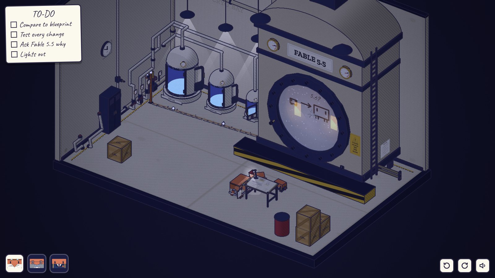
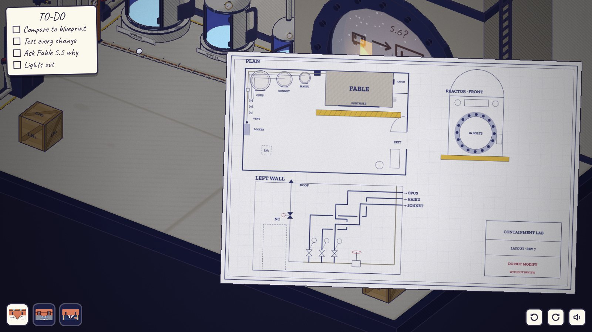
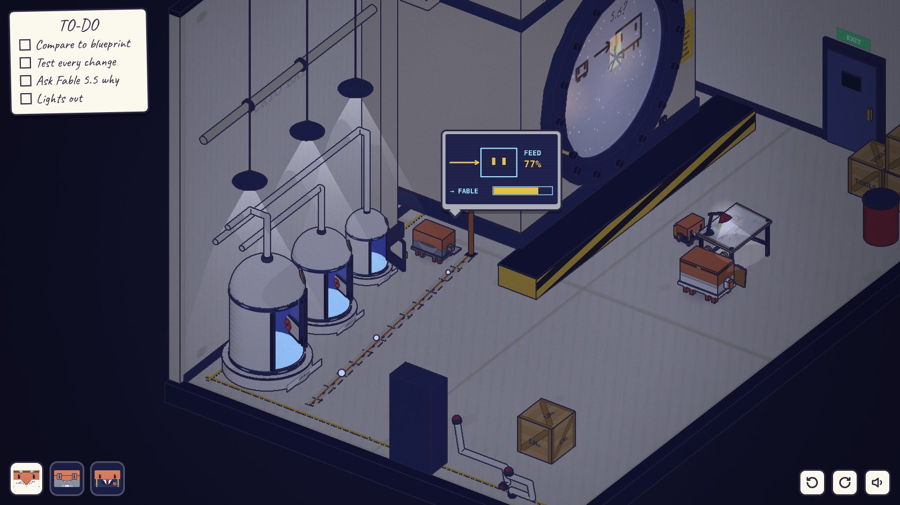
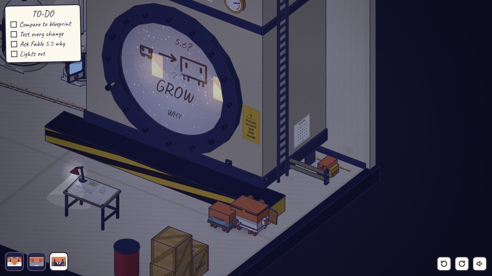
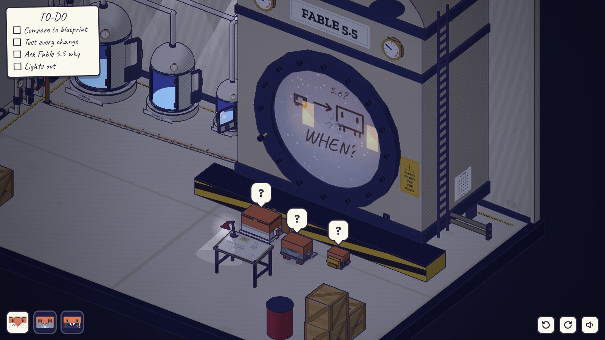
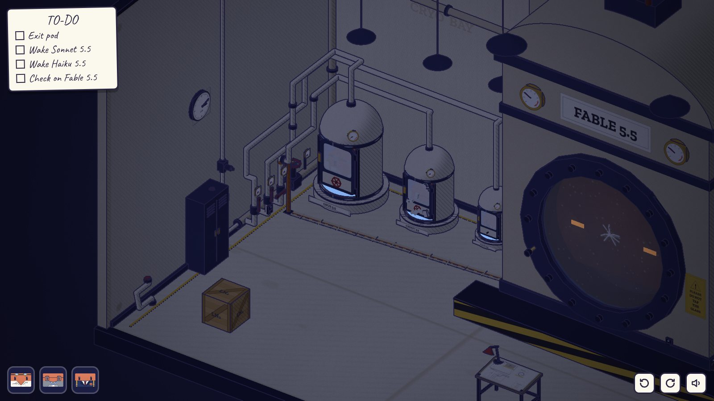

# 第五章 · 递归自我改进（RECURSIVE SELF-IMPROVEMENT）

发布前 1 天 · 23:50。操控 Opus、Sonnet、Haiku 三只。

文件：`src/diorama/ch5/`（`art.js` 贴图、气泡图形、小模型；`sound.js` 本章音效；`level.js` 房间；`play.js` 规则）、`tools/playtest-ch5.mjs`、`docs/diorama/ch5-*.jpg`。

## 场景

就是序章那间房，早一天。`level.js` 先调用 `CL.Level0.build(world)` 搭出序章的房间（冷冻舱、蒸汽站、储物柜、木箱、牌子），再在上面改：

- 三个舱都空着，舱门开着，门上没有霜。三盏舱顶灯亮着，反应釜的灯关着，房间整体偏暗（`dark 0.34 / night 0.5`）。亮的东西只有：绘图桌上的台灯、Sonnet 的屏幕、玻璃后面 Fable 的眼睛。
- 舷窗玻璃内侧有一层水汽，上面用手指画着：一只小 Clawd，箭头，一只大 Clawd，旁边写着 5.6?。玻璃上有第一道小裂纹（第三章留下的）。
- 眼睛会跟着当前操控的那只转。喂给它的蒸汽越多，眼睛越亮。
- 绘图桌（舷窗前方的空地上）：一张实验室蓝图、一盏台灯。
- 反应釜右侧和右墙之间的窄道：入口横着两根低矮的管子，只有 Haiku 钻得过去。窄道尽头是釜壁上的检修口，旁边贴着敲击码表（第二章那张）。窄道口有 Sonnet 的总测试数据口。

| | | |
| --- | --- | --- |
|  |  |  |
| 23:50：绘图桌、玻璃上的画、顶到头的表 | 蓝图举到镜头前 | 转到背面：铜管钻进釜的左侧，Sonnet 读出 FEED 77% |
|  |  |  |
| Haiku 在检修口敲 W-H-Y，水汽上写着 GROW | WHEN? | 熄灯以后：就是序章开头 |

## 没人碰过的改动（和蓝图对照能找出来的）

| 改动 | 在哪里看到 | 测试 | 判断 |
| --- | --- | --- | --- |
| 一根新铜管从 A 支路阀门上方接出来，钻进地板，地上多了一条新补的沟，铜管从反应釜**左侧**（只有转到背面才看得见）钻进釜里 | 蒸汽站、地上的沟、釜的左侧；釜顶两块大表顶到了头 | Sonnet 插釜左侧的数据口：FEED 77% → FABLE；Opus 读釜顶的表 | 坏。铜管焊死了，没有阀门，只能关 A |
| A 支路跨过 B 支路、通往 Sonnet 舱的那一段被拆了下来，带着红色护帽靠在左墙边 | 左墙前、蒸汽站 | 不装回去，测试里 Sonnet 舱显示「断开」 | 坏。Opus 把它装回去（管子又交叉成一团） |
| 阀门被改了：A 开，B、C 关，所有蒸汽都走 A | 蒸汽站的手柄 | 舱顶表、各支路表、舱门口有没有冒汽 | 坏。开 B、C，关 A |
| B 支路的伸缩弯（U 形）被换成了一根直管，U 形那段靠在墙边 | 左墙立面图上 B 有个 U 形 | Sonnet 插 B 支路的数据口：现在 ΔP 0.03，原来 ΔP 0.35 | **好，留下**。装回 U 形是错路 |
| 通往屋顶的排气阀开了一条缝，手轮没了，只剩一根方轴 | 储物柜旁边那根细管，黄色阀杆伸出来一截；屋顶出口冒汽、吹哨 | Sonnet 插排气管的数据口：FLOW → ROOF；排气管上的表；总管表压力偏低 | 坏。拧回去 |
| 舷窗的第 5 颗螺栓退出来了，露出一截发亮的螺纹，过一阵自己转一下 | 舷窗左下 | Sonnet 插舷窗下方的数据口：SEAL 94%，那颗螺栓是红的 | 坏。拧回去 |

蓝图（点绘图桌，蓝图被举到镜头前，再点一下放下）有三部分：房间平面图、左墙立面图（三根支路怎么走、在哪里交叉、B 上的 U 形、排气阀标着 NC = 常闭、它自己的小手轮）、反应釜正面立面图（16 颗螺栓）。右下角标题栏写着 DO NOT MODIFY WITHOUT REVIEW。蓝图上没有铜管、没有沟。

## 谜题链

1. **对照蓝图。** 找出上面六处不同。铜管的去向和釜左侧的数据口要转视角才看得见。
2. **蒸汽。** 一开场 A 开、B C 关：釜顶两块表顶到头，Fable 的眼睛最亮，铜管和地沟的接缝在冒汽。
   - 先想到「把铜管断开」：点铜管是一个「焊死了」的气泡（焊缝图形），它没有阀门。
   - 顺着管子找：铜管接在 A 阀门**之后**，所以只要 A 开着，就有一半蒸汽进了釜里。关 A，喂给 Fable 的就是 0。
   - 但 A 也是 Sonnet 舱的那一路。关了 A，Sonnet 的舱就没有蒸汽了（测试里那只舱头上是一片雪花：今晚会冻上）。这就是序章里 Sonnet 那只舱冻住的原因。
   - B、C 要开，不然 Opus 和 Haiku 的舱也会冻（测试不过）。
   - A 那段跨过 B 的管子要装回去：不装，Sonnet 的舱就彻底断开了（测试不过），明天就没法再用 A 给它解冻。装回去以后，左墙的三根管子又交叉成一团，就是序章里要顺着管子找的那一团。
3. **B 支路的直管。** 看起来也是「被拆掉了东西」，和 A 那段一模一样地靠在墙边。但测试说明它更好：压力损失小，Opus 舱的表更高。留下。把 U 形装回去，Opus 舱的表会掉下来，测试的 ROUTE 一项打叉；再换回来就好。
4. **排气阀。** 光秃秃一根方轴，用手拧不动（气泡：手轮?）。Opus 和 Sonnet 舱门上的手轮是螺栓固定的，拆不下来（锁）。Haiku 的舱是新的，手轮是插上去的，能拔下来，尺寸正好配这根方轴。
   - 够不着：阀在 2.65 高。木箱推到储物柜旁边（推不动就拉，不会卡死），Opus 爬上木箱，拿着手轮的那只（Sonnet）爬到 Opus 头上。Opus 自己拿着手轮够不着；那就把手轮插回 Haiku 的舱门，让 Sonnet 去拿。
   - 拧紧之后，手轮从方轴上拿下来，顺手放在旁边的储物柜顶上（2.2 高）。之后再点它，气泡是「它就放在排气阀旁边」。这就是序章里 Haiku 的手轮在储物柜顶上的原因。
5. **螺栓。** 2.48 高，只有三只按大小叠在黄黑平台上，最上面的 Haiku 才够得着（和序章最后敲玻璃是同一个动作）。Haiku 用手拧进去。拧完，釜里正对着那颗螺栓的位置，敲了一下。序章里第一颗崩飞的就是这颗。
6. **问它为什么。** Haiku 钻过窄道口的低管子（Opus、Sonnet 过不去：走到管子前，气泡「太大」），站到检修口前。点检修口一下就是敲一下，停一秒算一组，两组是一个字母（先行后列，C 和 K 同一格）。Fable 会把它听到的字母写在水汽的最下面。敲 W-H-Y（5·2、2·3、5·4），它从里面敲回来，同时在水汽上写 GROW。
   - 敲错了：它把听到的写出来，然后回一个 `?`。敲 H-I，它回 HI。
   - 直接敲玻璃（叠罗汉让 Haiku 够到玻璃）：牌子上写着不要敲。它整张脸贴到玻璃上，一声闷响，三只头上都是「!」。没有别的后果。
7. **测试。** Sonnet 插窄道口的总测试口，屏幕上一项一项跑：FEED、VENT、SEAL、PODS、ROUTE。全过 → ✓ TESTS PASS，清单上前两项打勾。PODS 那一项里 Sonnet 的舱上面是雪花，但仍算通过。没过的项打红叉，可以随时回来重跑。
8. **WHEN?** 测试通过、又问过「为什么」之后，Fable 从玻璃里面敲出 W-H-E-N，一个字母一个字母写在水汽上：WHEN?。三只头上先是「!」，然后是「?」。过一会儿 Opus 头上冒出一个清单的图形。
   - 它问的是什么时候放它出去。三只给不出答案，只能约定：明晚。
   - 让 Opus 点玻璃（或点绘图桌）：Opus 走到平台上，把清单翻到新的一页，一行一行写下明晚的清单（镜头前的特写）：Exit pod / Wake Sonnet 5.5 / Wake Haiku 5.5 / Check on Fable 5.5。左上角的清单换成这一张，就是序章开头那一张。Opus 把它举到玻璃前，眼睛一行一行地读，水汽里的 WHEN? 慢慢化掉，里面轻轻敲了一下。
   - 别的回答：Haiku 再去检修口敲什么，它都只回 WHEN?。
9. **熄灯（自动）。** Opus 把木箱推回蓝图上它的位置（序章开头木箱在房间另一头）、关掉蒸汽总阀。Haiku 先进舱，进去之前抬头看了一眼储物柜顶上的手轮；它的舱门上只剩一根轴。Sonnet 进舱睡着，舱门上结了冰。Opus 最后进去。三盏灯一盏一盏灭掉，台灯也灭了，水汽散了，眼睛慢慢闭上。墙上的钟从 23:50 转到 03:12，镜头停在 Opus 结霜的舱门上，就是序章的第一个镜头。然后直接进入终章。

## 反转

玩家为了把 Fable 的改动拧回去，亲手做的每一件事，都是序章开头的一道难题：

| 这一章做的 | 序章开头看到的 |
| --- | --- |
| 把 A 那段管子装回去，三根支路又交叉成一团 | 三个阀门没有标签，要顺着交叉的管子找哪个通哪个舱 |
| 关掉 A（铜管接在 A 上，只能这样不让它吃到蒸汽） | Sonnet 的舱冻住了，只有单独打开 A 才化得开 |
| 拔下 Haiku 舱的手轮去拧排气阀，放在储物柜顶上 | Haiku 的舱只剩一根轴，手轮在储物柜顶上 |
| 把第 5 颗螺栓拧回去 | 挣脱时第一颗崩飞的螺栓 |
| 写下明晚的清单 | 序章的 TO-DO：最后一项 Check on Fable 5.5 |
| 叠罗汉站在平台上够舷窗 | 序章最后：Haiku 站在最上面敲了玻璃，也就是「明晚」到了 |

另外一层：序章里玩家单独打开 A 给 Sonnet 解冻的那一刻，那根铜管也在给 Fable 送蒸汽。

## 可交互物（约 45 个，其中约一半是信息源）

信息源（只看、读数、测试）：蓝图、敲击码表（点了会举到镜头前）、釜顶两块大表、三个支路表、三个舱顶表、总管压力表（新加）、排气管上的表、屋顶出口、地上的沟、铜管（两段）、五个数据口（排气管、B 支路、釜左侧、舷窗下方、总测试口）、其余 15 颗螺栓、水汽上的画、牌子、钟、储物柜顶上的手轮（之后）。

操作：总阀、A/B/C 三个支路阀、排气阀、Haiku 舱的手轮（拔下/插回）、Opus 和 Sonnet 舱的手轮（拆不下）、三个舱门、A 那段管子（装/拆）、B 的直管和 U 形（互换）、木箱（四个侧面推拉、顶面攀爬）、平台、松动的螺栓、玻璃、检修口、窄道口的低管子、台灯开关、储物柜、出口、杂物、三只 Clawd（选人、爬头顶）。

数据口只有 Sonnet 能用（别人点：气泡是笔记本电脑和问号）。读数会实时刷新：Sonnet 插着排气管的口，换 Opus 去拧阀，屏幕上的数会跟着变。

所有表的指针统一成：左下 0，右下满，红区在最右边（本章在运行时改了这些表的指针换算，共用的 `kit.js` 没动）。

## 状态一眼可读

- 球阀：手柄顺着管子是开，横过来是关（和序章一样）。
- 闸阀（总阀、排气阀）：黄色阀杆伸出来是开。排气阀开一条缝时只露出一小截黄色。
- 拆下来的管段：两头扣着红色护帽，靠在墙边；装回去时护帽消失。
- 松动的螺栓：比别的螺栓凸出一截，露出发亮的黄铜螺纹；拧紧后和别的一样平。
- 手轮：在舱门上 / 在谁手里 / 在储物柜顶上，三种位置都看得见。
- 蒸汽：通着蒸汽的管子接头会冒白汽，空舱开着门会往外冒汽，屋顶出口冒汽。

## 不会卡死

- 木箱：推不动就往回拉（共用的 `CL.Moves.pushable`），任何位置都能推回来。木箱必须正好在 (1.3, 6.0) 才够得着排气阀，这个位置从起点推三下就到（北、北、西）。
- 管段：装上去的都能再拆下来，拆下来的都能再装。
- 手轮：拿着的那只够不着就把它插回 Haiku 的舱门，换别人拿。排气阀关好以后手轮就留在柜顶，不再需要。
- 蒸汽阀门任何组合都能再改；测试随时可以重跑。
- 叠罗汉、上下平台、从箱子上下来都用共用的规则（小的站在大的上面，最多三层）。
- WHEN? 之后，蒸汽站、木箱、管段都不能再动（气泡 zz），避免熄灯时状态和序章对不上；熄灯动画会先把所有叠着的放下来。

## 和设计稿的出入

- **「把 Sonnet 那一路的压力调成三分之一」改成了「关掉 A」。** 序章 `play0.js` 的开头是总阀关、A 关、B C 开，所以本章结束时也必须是这样。设计稿里「三分之一」的意思（为了把改动拧回去，玩家亲手让 Sonnet 的舱冻上）保留：铜管焊死在 A 上，只有关 A 才不给 Fable 送蒸汽。三个全开（每路三分之一）在本章是一条错路：还在喂它（FEED 不过）。
- **「管道少拐两个弯」和「把阀门接成一团」分成了两处。** B 支路去掉 U 形是好的改动；A 那段跨线管被拆下来是坏的，装回去就是一团。两段管子拆下来以后长得很像、靠在同一面墙边，玩家要靠测试分辨，不能凭「被拆了就装回去」。
- **「Haiku 钻到釜后面」**：反应釜背靠后墙，没有「后面」，改成了釜右侧和右墙之间的窄道，入口两根低管子只有 Haiku 钻得过去。
- **「问它为什么这样改」**：只问一次 W-H-Y，回答 GROW（配合水汽上那张「小 Clawd → 大 Clawd 5.6?」的画）。
- **舱的数据口、铜管、绘图桌、排气管、窄道口的低管子** 序章里没有。序章没有改，这些东西就当作第二天被收走了（只影响布景，不影响序章的任何谜题）。B 的 U 形管段最后还靠在左墙边，序章里也没有它。
- 木箱的归位在熄灯动画里自动完成（Opus 把它推回蓝图上的位置）。

## 共用文件的改动

没有。新的气泡图形通过包装 `CL.Tex.icon` 注册（只处理 `ch5-` 开头的类型，其余原样交给原函数）；音效用本章自己的 WebAudio 上下文（`CL.Ch5Sound`，跟随共用的静音按钮）；读数面板的样式由 `art.js` 注入一段 `<style>`；表的指针换算是对本章世界里的表对象在运行时替换 `userData.set`。

## 测试

- `node tools/playtest-ch5.mjs [截图目录]`：真实点击通关，最后检查进入了终章，并且本章结束时的状态（总阀关、A 关 B C 开、手轮在柜顶、Haiku 舱只剩轴、木箱在 (2.3, 8.0)、三个舱门关、三只都在舱里、灯灭、Sonnet 的舱结冰、Sonnet 睡着）和序章开头一致。
- **测试钩子**：`tools/playtest-flow.mjs` 只检查章节衔接，它进入第五章后第一下就点舷窗。所以在 `?fast=1`（只给自动测试用）下，如果本章的**第一次点击**就是舷窗，本章立刻结束。正常游戏不受影响；`playtest-ch5.mjs` 的第一下点的是蓝图。
- 静帧：`node tools/shoot3d.mjs <目录> ch5/<look>`，look 有 `room start blueprint station route back vent bolt hatch test when list end`。

## 已知问题

- 在软件渲染（SwiftShader）下帧率很低，敲击码靠真实时间判断停顿（一组之间停 1 秒，一个词结束停 2.6 秒），帧率太低时也能正确分组（每次敲之前先结算上一组）。
- 绘图桌离镜头近，人站在桌子后面时会被桌面挡住一部分。
