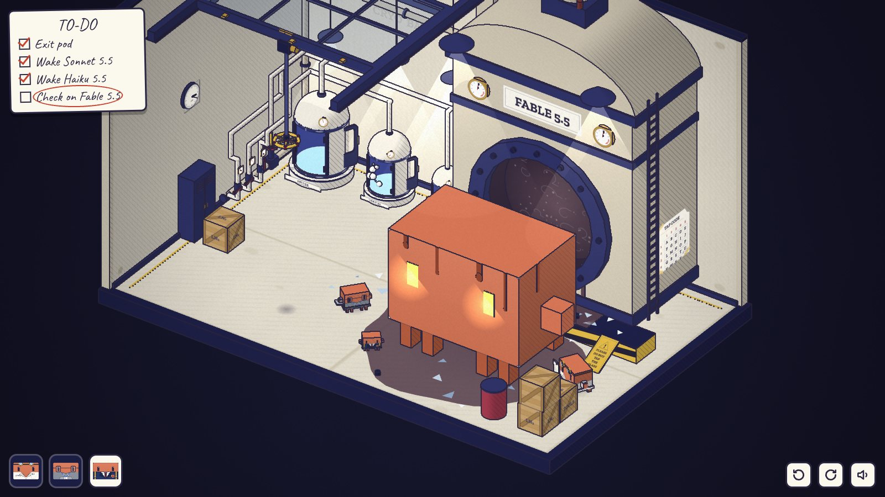
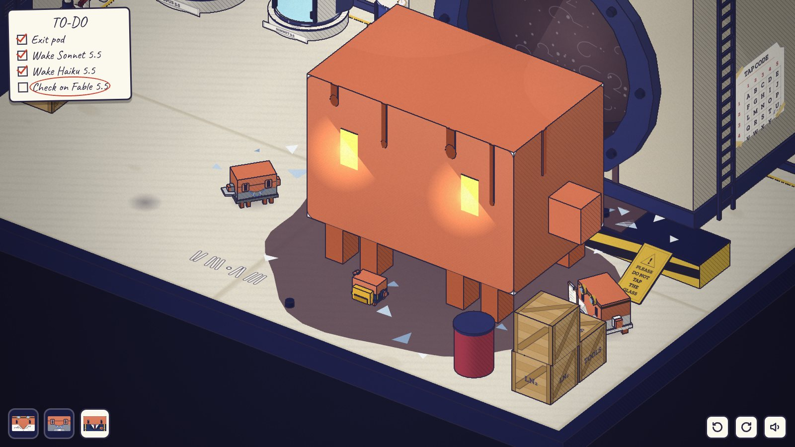
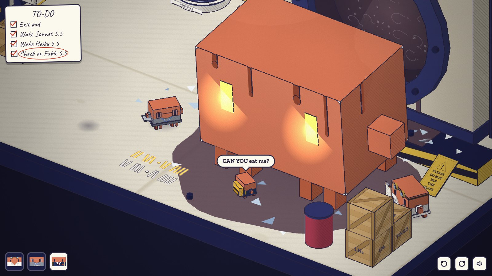
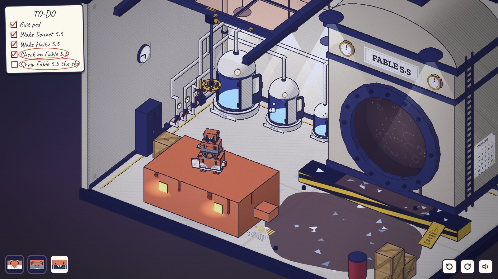
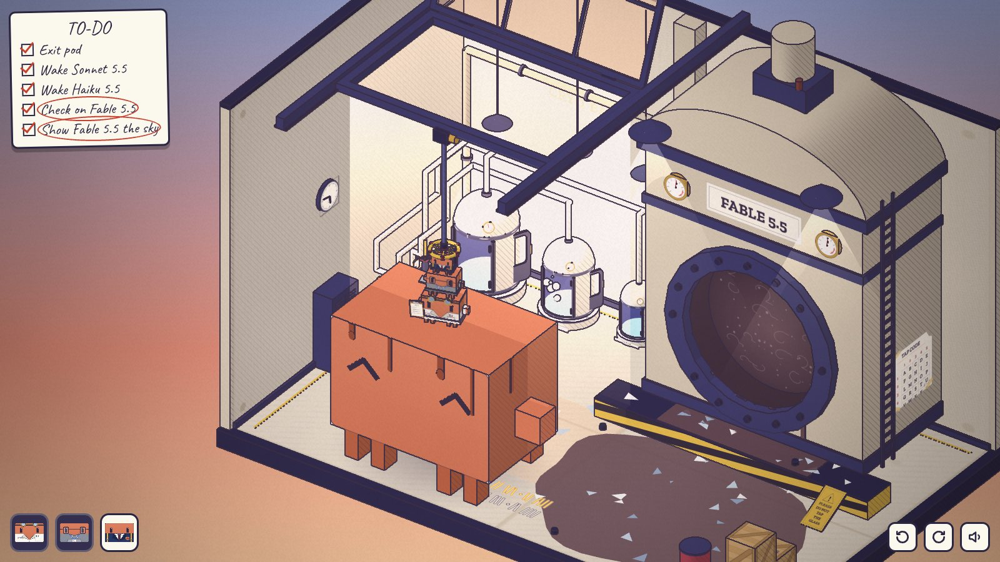
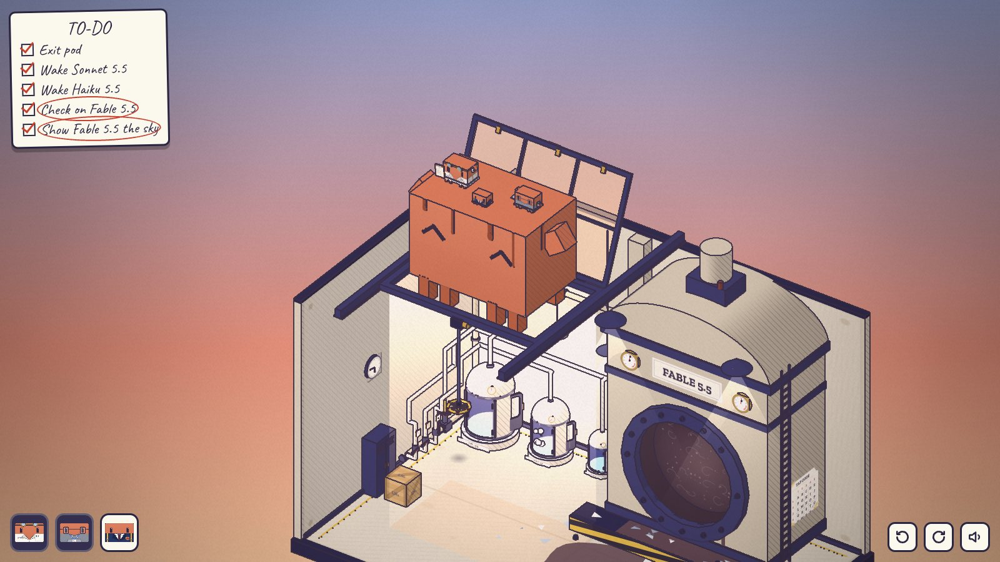

# 终章 · 发布之夜

> 03:21，没有标题卡。操控 Opus、Sonnet、Haiku；Fable 5.5 不是玩家角色，由规则驱动。
> 文件：`src/diorama/epilogue/`（`art.js` 贴图、气泡、片尾；`sound.js` 本章音效；`fable.js` Fable；`level.js` 房间；`play.js` 规则）。测试：`tools/playtest-epilogue.mjs`。

| | | |
| --- | --- | --- |
|  |  |  |
| 03:21，挣脱后的那一秒 | Haiku 在 Fable 脚下敲，地上的粉笔记下敲了什么 | CAN YOU eat me? |
|  |  |  |
| Fable 趴低，Opus、Sonnet、Haiku 叠在它背上，正对摇把 | 天窗打开，黎明照进来 | 三只坐在它头上，它从天窗浮出去 |

## 场景

序章的那间房（直接调用 `CL.Level0.build`，不改 `level0.js`），停在挣脱后的那一秒：

- 舷窗的玻璃没了，空腔里只剩浊液；三颗螺栓掉在地上和平台上；玻璃碴撒满平台和地面；浊液从舷窗下沿流到平台上，Fable 落地的地方一大摊。
- PLEASE DO NOT TAP THE GLASS 的牌子被震下来，斜靠在平台脚下。它的背面刻着敲击码（`CL.Tex.sign(null, true)` 本来就有的那一面）。
- 三个舱门开着，里面空了；Haiku 的手轮装回去了；木箱在储物柜旁边；蒸汽站停在序章解开时的样子（总阀开，只开 Sonnet 那一路）。警报停了，灯亮着，钟停在 03:21。
- 釜的右侧面贴着第二章的敲击码表（TAP CODE，行号列号是红字，缺了一个角，K = C）。
- **屋顶的天窗（新）**：冷冻舱区上方两根屋梁之间，一扇 6 × 3.6 的天窗（Fable 正好过得去），后沿铰接，六块玻璃。前沿挂着齿轮箱，一根长杆垂下来，底端是一个安全黄的摇把，离地 6.1。摇把是黄的，免得和后面那排红色的蒸汽阀混在一起；它正下方的地面（或 Fable 的背）上有一小块影子，标出它的位置。
- **Fable**：4.8 倍大的 Clawd，琥珀色的眼睛还在发光，身上挂着浊液。它坐着有 4.0 高；趴低时身体压扁、落到地上，背只有 1.76 高，变成一块能站人的平台。

## 谜题链

### 1. H · I（敲击码）

- Fable 坐在浊液中间，呼吸，眼睛跟着当前角色转。Opus、Sonnet 走近，它低吼、眼睛一亮，角色头上冒 `!` 跳开；这时 Haiku 头上冒出「敲」的气泡（两个同心圆）。
- 开场 Haiku 头上冒出「打招呼」的气泡（举起一只手的小 Clawd）：它想说 HI。
- 用 Haiku 点 Fable：第一下 Haiku 走到它脚下；站好以后，每点一下敲一下（敲在 Fable 前脸上，一圈波纹，一声「嗒」）。点得快也不会丢，敲击会排队。
- **每敲一下，地上多一道白色粉笔线。** 停 1.5 秒，这一组结束，粉笔线之间空出一格。两组是一个字母（先行后列），字母完成时 Fable 眨一下眼、哼一声，粉笔写下一个「·」。
- 两个字母敲完就判定：H · I = 2、3 · 2、4。对了，Fable 用爪子在地上回敲 2、3 · 2、4，每一下地面一震，粉笔下面多一行琥珀色的线（它的回答，黑暗里也看得见）。清单上 Check on Fable 5.5 打勾。
- 敲错了：Fable 歪头冒 `?`，「嗯？」一声，粉笔被抹掉，Haiku 再冒一次「打招呼」。
- 码表在釜的右侧面（缺角，但 H、I 那一行完整），牌子背面还有一份刻的。

### 2. CAN YOU eat me?

自动进行，大约 15 秒：Haiku 说「CAN YOU eat me?」（对话气泡）。Fable 一动不动，灯一盏一盏灭掉，只剩一双琥珀色的眼睛。三声心跳，眼睛一下比一下低、一下比一下近，镜头推到眼前——CHOMP，全黑。黑暗里只有钟在走，七下嘀嗒，03:21 走到 05:47。

再亮起来：Fable 趴低了身子，Haiku 坐在它背上，冒出一颗心。吃掉其实是托起（第四章鲸鱼和小鱼的那一套）。灯重新亮起，天窗的玻璃透出一点粉色，Fable 抬头看着天窗，头上冒出「太阳」的气泡。清单多了一行：Show Fable 5.5 the sky。

### 3. 最大的那一块

要做的事：摇开天窗。规则都在现场：

- **摇把太高。** 谁站在地上去摇都只能冒「够不着」。三只在地上叠成序章那一摞也只到 2.1。
- **Fable 的背是一块平台。** 它趴着时，点它的背或侧面，角色就跳上去（1.76，刚好跳得上）；可以在背上走，点地面就从最近的边跳下去。点一只站在它背上的 Clawd 的头，会先跳上背、再爬上去。
- **Fable 会站起来帮忙。** 背上有谁去够摇把，它就站起来（背升到 4.0），够不到就再趴下。
- **小的站在大的上面。** Fable 4.0 + Opus + Sonnet + Haiku 正好 6.1；少一只、换个顺序都不够，大的爬小的照旧冒「太重」。
- **Fable 不在摇把下面。** 它趴在了舷窗前。它跟着 Haiku：Haiku 在地上离它远远地站定，Fable 就站起来，横着（像螃蟹一样）走过去，把 Haiku 一托抛到自己背上，就地趴下。背上有别人，它也驮着一起走；Haiku 正好落在背上那一摞的顶上时，就落在那一摞上面。
- 所以最自然的一步「让 Haiku 去摇摇把」本身就把 Fable 领到了摇把下面。之后 Haiku 在背上让开，Opus 跳上来站到摇把正下方（看影子），Sonnet 爬 Opus，Haiku 爬 Sonnet，再摇。

### 4. 黎明

Haiku 摇了三圈，三个铜卡子缩回去，天窗向后翻开。风声，一个慢慢铺开的大三和弦；粉橙色的光柱从天窗落下来，箱庭外面的背景从夜色变成黎明（`P.SKY`、`P.DAWN_LO`、`P.DAWN_HI`）。Fable 的眼睛变成 ^ ^。三只从叠罗汉上下来，并排坐在它头上，它退到天窗正下方，像鲸鱼一样慢慢浮起来，穿过屋顶，镜头跟着升到箱庭上方。这是它第一次不隔着玻璃看外面。

### 5. 片尾

淡出到黑：**FABLE 5.5**，一道橙线，Is it finally time? It's time. 三秒后，Haiku 的小头像旁边弹出最后一句「CAN YOU eat me again?」。然后 `api.finish()`：黑底上只有「再玩一次」。片尾的字留在按钮上方（`pointer-events: none`），点「再玩一次」时移除。

## 错路和反馈

| 错路 | 反馈 |
| --- | --- |
| Opus 或 Sonnet 去碰 Fable | 它低吼、眼睛一亮、往前一探；角色冒 `!` 跳开；Haiku 冒「敲」 |
| 行列敲反（M R）、乱敲、一组超过 5 下、只敲一个字母就停 | 粉笔照实记下；Fable 歪头冒 `?`，「嗯？」，粉笔抹掉，Haiku 冒「打招呼」 |
| 在地上去摇摇把（任何人、任何地上的叠法） | 角色伸手，冒「够不着」 |
| 只有 Haiku（或少一只）在 Fable 背上去摇 | Fable 站起来帮忙，还是差一点，冒「够不着」，它再趴下（这一步告诉玩家 Fable 会当底座） |
| 大的爬小的（Opus 爬 Sonnet / Haiku） | 下面那只被压扁一下，冒「太重」 |
| Fable 站着时想跳上去 | 冒「够不着」 |
| 叠好了但 Fable 不在摇把下面 | 冒 `?`。把 Haiku 带到摇把下面，Fable 就跟过来 |
| Haiku 走到 Fable 去不了的地方（舱之间、墙角） | Fable 走到最近的地方趴下，不托它 |

没有死局：Fable 趴着时，它的背从任何一边都能跳上跳下，所以它挡住的地方总能翻过去；Haiku 随时能把它领走。

## 可交互物（约 30 个，约三分之一是信息源）

Fable（敲 / 低吼 / 跳上背）、Fable 的背、黄色摇把、天窗、齿轮箱和杆、敲击码表、倒下的牌子（点一下翻面）、地上的两条粉笔（可以走上去）、钟、上锁的出口、储物柜、木箱、角落的箱子和桶、三个空舱、总阀、三个支路阀、三块支路压力表、釜上两块压力表、空舷窗（圈、空腔、浊液）、三颗螺栓、三只 Clawd。

信息源：码表、牌子背面、粉笔（自己敲的和 Fable 回的）、Haiku 和 Fable 的气泡（打招呼、敲、太阳）、Fable 的视线（先看当前角色，后来看天窗）、天窗玻璃的粉光、摇把下的影子、压力表、钟。

## 和设计稿的出入

- 敲击码不对着玻璃敲（玻璃没了），敲在 Fable 身上；「停顿」靠 1.5 秒不点；敲了什么由地上的粉笔显示，Fable 的回答是琥珀色的另一行。
- 天窗是新加的：序章的房间没有屋顶，所以只画了两根屋梁、一圈窗框和一扇天窗。够不到屋顶，所以用一根长杆把摇把垂到 6.1。
- 设计稿说 Fable 趴低是黑暗之后的结果；这里加了「它跟着 Haiku」这一条，用来把它领到摇把下面（订单里「maybe Fable must first be coaxed」那一步）。
- 清单多了第五行 Show Fable 5.5 the sky（只写目标），在黑暗之后出现。
- 片尾的字留在「再玩一次」的黑卡上方，而不是单独一张。

## 共用文件的改动

没有改共用文件。本章在自己的文件里做了这些运行时的扩展：

- 新的气泡图形（打招呼、太阳）和对话气泡：先调用 `world.bubble(a, 'blank')`，再替换它生成的 DOM（`world.bubbles` 的最后一个）；对话气泡加 `.say` 类，样式在 `art.js` 注入的 `<style id="epi-style">` 里。
- Fable 不是 `Actor`（不加进 `CL.Engine.SPECS`）：它不能被选中，也不该被 Tab 切到。它是一个 `CL.Kit.clawd` 模型加一个带 `x, y, z, height, spec.W, carrying` 的对象，所以 `world.bubble` 也能用在它身上。
- 音效：`sound.js` 的 AudioContext 是私有的，本章开一个自己的小 AudioContext（第一次出声时创建，跟随共用的静音按钮）。
- 样式：`art.js` 往 `<head>` 注入一段 `<style id="epi-style">`（对话气泡、片尾、`body.epi-end` 隐藏 HUD、`.screen button[hidden]`，见「已知问题」）。
- 走路网格：Fable 的占地每次变化时，从开局保存的网格副本恢复，再写入「趴着时的背 = 1.76 高的地面，四周一圈封住」。上下 Fable 的背用跳（`travel()`），不改 A*。

## 测试

- `node tools/playtest-epilogue.mjs [截图目录]`：真实点击通关，并走几条错路：Opus 被吼、行列敲反、Opus 在地上摇摇把、Haiku 去摇摇把（Fable 跟过去）、只有 Haiku 在背上去摇、Opus 爬 Haiku；最后等到「再玩一次」出现。
- `node tools/shoot3d.mjs out epilogue/<look>`，look：`room`、`knock`、`answer`、`ask`、`dark`、`hatch`、`lead`、`stack`、`dawn`、`float`、`end`。

## 已知问题

- `tools/playtest-flow.mjs` 从第五章进入终章后 1.5 秒点舷窗，等着最后的黑卡。为了让它在真正的终章里也通过，**只在 `?fast=1` 且不是用 `?ch=epilogue` 直接打开时**，点 Fable 或舷窗会立刻结束本章（`play.js` 里的 `SMOKE`）。玩家不会带 `?fast=1`。建议以后让这个冒烟测试改用 `window.__probe.finish()`（本章已提供），然后删掉 `SMOKE`。
- **共用 CSS 的两个 `[hidden]` 失效（建议在 `game.css` 里统一修）：**
  - `.screen button { all: unset }` 把 `[hidden]` 也重置了，所以每一张标题卡上「开始」和「再玩一次」会同时出现，最后的黑卡也会多一个「开始」。本章在自己注入的样式里加了 `.screen button[hidden] { display: none !important; }`，所以终章的黑卡只有「再玩一次」（这条规则在终章加载后对整页生效，只会让其他卡片也变对）。建议在 `game.css` 加上同样一行。
  - `.hud-tl / .hud-bl / .hud-br` 的 `display: flex` 盖过了 `[hidden]`，所以 `hud.show(false)` 和 `finish()` 都藏不住 HUD（平时被黑卡盖住看不出来）。片尾为此给 `body` 加了 `epi-end` 类来隐藏 HUD，「再玩一次」时去掉。
- 天窗离地 9.6，默认镜头（33°）下它在画面上方；黑暗之后镜头跟随的高度调高了（`followY` 3.4），但缩得很近时仍可能看不到天窗，需要滚轮拉远。
- Fable 横着走时是直线移动，不绕障碍；它能去的范围（`REGION`）已经避开了舱、木箱、储物柜、平台和角落的箱子。
